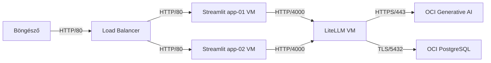

# OCI workshop alkalmazások telepítése Cloud Shellből

**Kiindulás:** minden résztvevő OCI-adminisztrátori fiókkal dolgozik. Az infrastruktúrában már van VCN, privát subnet, három Ubuntu 24.04 x86_64 VM, Load Balancer és menedzselt PostgreSQL 16. A VM-ek SSH-felhasználója `ubuntu`, van sudo-jogod, és a VM-ekről működik a csomagletöltés. Más OS, felhasználó vagy architektúra esetén előbb egyeztess az oktatóval.

**Telepítési útvonal:** böngésző → OCI Cloud Shell Private Network Access → közvetlen SSH a privát VM-ekre. A Cloud Shellhez rendelt privát hálózatnak el kell érnie mindhárom VM-et.

**Alkalmazások:** két külön VM-en ugyanaz a Streamlit app fut, a harmadik VM-en egy közös LiteLLM. Az LB mindkét appot HTTP/80-on éri el; a Streamlit szolgáltatások közvetlenül a 80-as porton figyelnek. Mindkét app a LiteLLM privát IP-jét hívja a 4000-es porton. A GenAI API-kulcsot és a PostgreSQL-kapcsolatot a LiteLLM használja. A Cloud Shell csak telepítőterminál. SSH-belépés után a LiteLLM VM-en a `scripts/install_litellm.sh`, mindkét app VM-en a `scripts/install_app.sh` végzi egyben a telepítést.



**Jelölések:** CLOUD SHELL = a Console-ban megnyitott terminál; LITELLM = az onnan SSH-val elért LiteLLM VM; APP-01 / APP-02 = az onnan SSH-val elért megfelelő Streamlit VM; CONSOLE = OCI Console; BÖNGÉSZŐ = a saját gépeden futó böngésző. A VM-ek `sudo apt-get` parancsait csak a megfelelő VM-re belépve futtasd. Hiba esetén az adott lépésnél állj meg.

**A p01 tesztkörnyezethez:** a [CLOUDSHELL-p01.hu.md](CLOUDSHELL-p01.hu.md) tartalmazza a konkrét hálózati neveket, címeket és a meglévő SSH-kulcs feltöltését. A telepítést ezen a fő guide-on végezd sorban.

**Indulás a Console-ban:** válaszd ki az infrastruktúra régióját, majd a fejléc **Cloud Shell / Code Editor → Cloud Shell** menüpontját. A Cloud Shell régiója is egyezzen a VCN régiójával. Ha a tenancy home régiója eltér, használd a Cloud Shell regional launch lehetőségét; az 5. fejezet hálózati választójában csak a Cloud Shell régiójának VCN-jei jelennek meg. A terminál megjelenése után:

```bash
cd ~
umask 077
mkdir -p ~/.ssh
chmod 700 ~/.ssh
```

A Cloud Shell **Upload** menüjével vagy a fájlok terminálablakba húzásával tölthetsz fel fájlokat. Feltöltés előtt lépj a home könyvtáradba; az alábbi parancsok az ide feltöltött fájlokra hivatkoznak. A saját géped `/Users/...` vagy `C:\...` útvonalai nem léteznek a Cloud Shellben. A feltöltés után ellenőrizd a fájlt `ls -l ~/FAJLNEV` paranccsal. Ha máshová került, a feltöltés helyéről mozgasd a megadott célra.

[Oracle Cloud Shell és fájlfeltöltés](https://docs.oracle.com/en-us/iaas/Content/API/Concepts/devcloudshellgettingstarted.htm)

## 1 OCI API kulcs létrehozása

**CONSOLE:** profilmenü → **User settings → Token and keys / API keys → Add API Key**.

1. Válaszd a **Generate API Key Pair** lehetőséget.
2. Töltsd le a **private key** fájlt a böngészővel. A 7. fejezetben töltöd fel a Cloud Shellbe és másolod tovább a LiteLLM VM-re.
3. Kattints **Add**.
4. A Configuration File Preview adataiból másold ki: `user`, `fingerprint`, `tenancy`.

[OCI API kulcs lépések](https://docs.oracle.com/en-us/iaas/Content/API/Concepts/apisigningkey.htm)

Az SSH-kulcs és az OCI API-kulcs két külön fájl: előbbivel a VM-ekre lépsz be, utóbbival a LiteLLM hívja az OCI GenAI-t.

A Cloud Shell előre hitelesített OCI CLI-je nem helyettesíti a VM-en futó LiteLLM saját OCI API-kulcsát. A Cloud Shell `/etc/oci` sessionkonfigurációját ne másold a VM-ekre.

## 2 SSH kulcs előkészítése a VM-ek eléréséhez

Ez az SSH-kulcs a három VM-re belépéshez kell. A repository letöltését a 3. fejezet HTTPS-en, GitHub-bejelentkezés nélkül végzi.

### 2.1 Ha már van kulcsod a meglévő VM-ekhez

**CONSOLE / CLOUD SHELL:** a Cloud Shell **Upload** menüjével töltsd fel a meglévő privát SSH-kulcsot. A következő példa a `p01-vm-key` nevű fájlt használja; más fájlnévnél cseréld ki a forrás nevét. A teljes fájlnév kell, az esetleges `.key` kiterjesztéssel együtt.

Ha a `~/.ssh/oci-ai-workshop` már létezik, az alábbi importálást ne futtasd rá újra; használd a már importált megfelelő kulcsot.

**CLOUD SHELL:**

```bash
chmod 600 ~/p01-vm-key
install -m 600 ~/p01-vm-key ~/.ssh/oci-ai-workshop
rm ~/p01-vm-key
ssh-keygen -y -f ~/.ssh/oci-ai-workshop > ~/.ssh/oci-ai-workshop.pub
chmod 644 ~/.ssh/oci-ai-workshop.pub
```

Ha a privát kulcs jelszót kér, add meg a kulcs védőjelszavát. Ezután folytasd a 2.3 ponttal.

### 2.2 Ha új SSH kulcspárt kell létrehoznod

Ezt a pontot csak akkor végezd el, ha a 2.1 pontban nem importáltál meglévő kulcsot.

**CLOUD SHELL:**

```bash
ssh-keygen -t rsa -b 4096 -C "oci-ai-workshop" -f ~/.ssh/oci-ai-workshop
chmod 600 ~/.ssh/oci-ai-workshop
```

Adj meg kétszer egy kulcsot védő jelszót. A gépelés nem látszik. Meglévő fájl felülírására válaszolj `n`-nel.

### 2.3 A publikus kulcs ellenőrzése

**CLOUD SHELL:**

```bash
cat ~/.ssh/oci-ai-workshop.pub
```

A kiírt teljes egyetlen sor a **publikus kulcs**. Ennek szerepelnie kell mindhárom VM-en az `ubuntu` felhasználó `~/.ssh/authorized_keys` fájljában. Ha a VM-eket az importált kulccsal készítették, ez már teljesülhet. Új kulcsnál az infrastruktúra gazdája vegye fel a publikus sort a meglévő adminisztrációs elérésén. Az új kulcs létrehozása önmagában nem ad belépési jogot; csak az engedélyezés után folytasd.

A privát fájl a Cloud Shellben marad, nem másoljuk a VM-ekre. Az `IdentityFile` minden résztvevőnél a `~/.ssh/oci-ai-workshop` fájlra mutat. Saját kulcsot használj, ne közös workshop-kulcsot.

[Oracle SSH kulcspár](https://docs.oracle.com/en-us/iaas/Content/Compute/Tasks/managingkeypairs.htm) · [Publikus kulcs engedélyezése](https://docs.oracle.com/en-us/iaas/Content/Compute/Tasks/addingusers.htm)

## 3 Saját adatok és a Git repository klónozása

**CONSOLE:** válaszd ki a saját régiódat és compartmentedet.

1. **Compute → Instances → LiteLLM VM:** jegyezd fel a Private IP-t, a VCN és a subnet nevét.
2. **Compute → Instances → app-01 és app-02 VM:** jegyezd fel mindkettő Private IP-jét, VCN-jét és subnetjét. A böngészőből a két app elé tett Load Balancer URL-jét fogod használni.
3. **Databases → PostgreSQL → DB Systems → saját DB:** válaszd ki az infrastruktúra compartmentjét, majd a DB systemet. Az állapota legyen **Active**, a PostgreSQL főverziója **16**. A **Connection details** részből másold ki a **primary FQDN**-t, és töltsd le a **CA certificate** fájlt. A reader endpoint nem megfelelő. Más verziónál itt állj meg, és egyeztess az oktatóval.
4. Legyen meg a DB létrehozásakor beállított **PostgreSQL adminnév és adminjelszó**. Ez külön DB-hitelesítés: az OCI Console felhasználója és az OCI API-kulcs nem helyettesíti. A külön `litellm` DB-t és DB-felhasználót a 7.5 pontban készítjük el, még a LiteLLM telepítése előtt.
5. Az oktatótól kérd el a workshop **GenAI-régióját, modellazonosítóját és használható inference compartmentjét**. Az inference compartment Details oldalán a **Copy OCID** gombbal másold ki az OCID-t.

A klónozás után az `Applications/templates/ADATLAP.txt` fájlba írd a nem titkos adatokat. Jelszót a jelszókezelődben tarts. Minden résztvevő a saját IP-címeit és OCID-jeit használja.

### 3.1 GitHub hálózati elérés

**CONSOLE, Cloud Shell felső sáv → Network:** a klónozáshoz válaszd a **Public Network** módot. Ha már a privát hálózatot használod, és annak NAT/kimenő szabályai engedik a GitHubot, ott is klónozhatsz; egyébként a klónozás után az 5. fejezetben váltasz Private Network Accessre.

Az alapértelmezett OCI Service Network mód önmagában nem ad általános GitHub-internetelérést. [Oracle Cloud Shell Networking](https://docs.oracle.com/en-us/iaas/Content/API/Concepts/cloudshellintro_topic-Cloud_Shell_Networking.htm)

### 3.2 A repo letöltése

**Előfeltétel az oktatónak:** a repository legyen nyilvánosan olvasható, és az `Applications` mappa módosításai már legyenek fent a GitHubon. A workshop forrása: [norbsch/ocitestdrivebudapest](https://github.com/norbsch/ocitestdrivebudapest).

**CLOUD SHELL:**

```bash
cd ~
git clone https://github.com/norbsch/ocitestdrivebudapest.git
```

**Elvárt:** a repository letöltődik GitHub-felhasználónév, jelszó, token és GitHub SSH-kulcs megadása nélkül. Ha mégis hitelesítést kér, jelezd az oktatónak, hogy ellenőrizze a repo nyilvános olvashatóságát. Ha a klón könyvtára már létezik, ne klónozz rá újra; használd a már meglévő példányt.

### 3.3 A klónozott tartalom ellenőrzése

**CLOUD SHELL:**

```bash
cd ~/ocitestdrivebudapest/Applications
ls -a
ls app proxy tools templates scripts
nano templates/ADATLAP.txt
```

**Elvárt:** az `Applications` alatt van az `app`, `proxy`, `tools`, `templates`, `scripts` mappa és a `.gitignore`. A név kis- és nagybetűérzékeny. Az alkalmazások forrását nem kell ZIP-ben feltölteni. Az SSH privát kulcsát, az OCI API-kulcsot és a CA-fájlt továbbra is külön, a guide megfelelő pontján kezeled.

Nano mentés: Ctrl+O → Enter → Ctrl+X. A további szerkesztéseknél is így használd.

A p01 környezetben a két meglévő app címe `10.0.1.2` és `10.0.1.3`. A külön LiteLLM VM címét az infrastruktúra gazdájától kérd el; az egyik app címét ne használd LiteLLM-címként.

A GitHubra a legújabb telepítőszkripteknek és segédfájloknak is fel kell kerülniük. Ha a `scripts/prepare_postgres.sh`, `scripts/install_litellm.sh` vagy `scripts/install_app.sh` hiányzik, ne folytasd a régebbi repo-verzióval.

## 4 A hálózati szabályok ellenőrzése

**CONSOLE → Networking → Virtual Cloud Networks → saját VCN → Network Security Groups:** hozz létre egy `workshop-cloudshell-nsg` nevű NSG-t, ha az infrastruktúra még nem biztosít külön Cloud Shell NSG-t. Ezt a Cloud Shell hálózati VNIC-jéhez fogjuk rendelni; a VM-ekhez nem ezt, hanem a VM-ek saját NSG-jét használd. A Cloud Shell NSG-jében engedélyezd a stateful egress TCP/22 kapcsolatot külön a LiteLLM, app-01 és app-02 VM privát IP-jére `/32` céllal, source port All értékkel.

**A VM-ek és a DB NSG-iben:** Ha külön Security fül van, ott találod az NSG-ket. Az infrastruktúráddal létrehozott csoportokban ellenőrizd vagy add hozzá a következő **stateful ingress** szabályokat:

| Célhoz rendelt NSG | Source Type | Source | Protocol | Source port | Destination port |
| --- | --- | --- | --- | --- | --- |
| Mindhárom VM | Network Security Group | Cloud Shellhez rendelt `workshop-cloudshell-nsg` | TCP | All | 22 |
| LiteLLM VM | CIDR | app-01 privát IP-je `/32` | TCP | All | 4000 |
| LiteLLM VM | CIDR | app-02 privát IP-je `/32` | TCP | All | 4000 |
| PostgreSQL | CIDR | saját LiteLLM VM privát IP-je `/32` | TCP | All | 5432 |
| Mindkét app VM | Network Security Group | az LB-hez rendelt NSG | TCP | All | 80 |

A táblázat normál OCI Load Balancert és HTTP/80 app-backendet feltételez. Az LB NSG-jén a listener portjára legyen engedélyezve a böngészők forgalma, az LB kimenő szabályai pedig engedjék az app-01:80 és app-02:80 kapcsolatot. Ha az LB nem használ NSG-t, a hálózat gazdája adja meg helyette a megfelelő forrás-CIDR-t. Más backend port vagy Network Load Balancer esetén előbb egyeztesd a szabályokat az infrastruktúra gazdájával.

Az SSH TCP/22 forrása a Cloud Shell privát hálózati VNIC-jéhez rendelt NSG. Az 5. fejezetben ezt csatolod a Cloud Shellhez. A VM-ek kimenő csomagletöltése, DNS-e és a LiteLLM → GenAI HTTPS/443 elérése is szükséges. A Cloud Shell SSH-kapcsolata nem biztosít internetelérést a VM-eknek: a privát subnethez legyen megfelelő NAT gateway vagy meglévő csomagtükör/proxy.

A DB system részleteinél a **Network security groups** beállításban ellenőrizd, hogy a TCP/5432 szabályt tartalmazó NSG ténylegesen a DB systemhez van rendelve. A szabály puszta létrehozása nem elég. A LiteLLM VM NSG-jének/security listjének kimenő szabálya is engedje a DB privát címére a TCP/5432-t. A két subnet között legyen útvonal; a primary FQDN-t a VM DNS-ének fel kell tudnia oldani. A PostgreSQL-hez a LiteLLM VM-ről kapcsolódunk, nem a saját gépről.

[OCI NSG lépések](https://docs.oracle.com/en-us/iaas/Content/postgresql/update-db-nsg.htm) · [OCI PostgreSQL kapcsolat és CA](https://docs.oracle.com/en-us/iaas/Content/postgresql/connect-to-db.htm)

**NSG hozzárendelése a DB-hez:** PostgreSQL DB system → **Network configuration → NSGs → Edit** → válaszd a DB NSG-jét → **Save changes**.

**NSG hozzárendelése a VM-hez:** Compute → Instances → VM → **Attached VNICs** → primary VNIC → **Network Security Groups → Edit** → válaszd a megfelelő NSG-t → Save. Az új felület ezt a VM Networking fülén is megjelenítheti.

Az alkalmazás- és DB-portokat a meglévő security listek is biztosíthatják. A fenti SSH-forrásként használt NSG-hivatkozást viszont a VM NSG-jében kell felvenni. Ha a VM-ekhez nem rendelhető NSG, az infrastruktúra gazdájával egyeztess megfelelő CIDR-alapú SSH-szabályt a Cloud Shell privát hálózati eléréséhez.

Ha az infrastruktúra gazdája már más nevű Cloud Shell NSG-t biztosított, mindenhol azt válaszd a `workshop-cloudshell-nsg` helyett. A VM-ek operációs rendszerének tűzfala is engedje a Cloud Shell privát hálózatából az SSH-t; ezt szükség esetén az infrastruktúra gazdája állítja be.

Mindkét app VM kimenő szabálya engedje a LiteLLM privát IP-jét TCP/4000-en. A LiteLLM kimenő szabályai engedjék a PostgreSQL TCP/5432 és a GenAI HTTPS/443 elérését. Az app VM-ekre az OCI API-kulcsot és a DB-jelszót nem másoljuk fel.

## 5 Cloud Shell Private Network Access és SSH

### 5.1 Privát hálózat csatlakoztatása

**CONSOLE, a Cloud Shell felső sávjában:**

1. Nyisd meg a **Network** legördülő menüt.
2. Válaszd a **Private Network Definition List → Create private network definition** lehetőséget.
3. Name: `workshop-private-network`.
4. Compartment / VCN: a három VM-et tartalmazó hálózat compartmentje és VCN-je.
5. Subnet: a három VM-et elérő privát subnet. Legyen benne szabad IP-cím a Cloud Shell hálózati VNIC-jének.
6. Network Security Groups: a 4. fejezetben előkészített `workshop-cloudshell-nsg`.
7. Jelöld be a **Use as active network** lehetőséget, majd **Create**.
8. Várd meg a csatlakozást, és ellenőrizd, hogy a **Network** mező a létrehozott privát hálózatot mutatja.

Ha a felület először meglévő definíciót kér, az infrastruktúrához előkészített definíciót is kiválaszthatod; ugyanaz a VCN/subnet és Cloud Shell NSG legyen hozzárendelve. A subnetből mindhárom VM-hez legyen hálózati út. A Cloud Shell alapértelmezett **OCI Service Network** módja ehhez a közvetlen privát SSH-hoz nem elég.

[Oracle Cloud Shell Private Networking](https://docs.oracle.com/en-us/iaas/Content/API/Concepts/cloudshellintro_topic-Cloud_Shell_Networking.htm)

### 5.2 SSH aliasok

**CLOUD SHELL:**

```bash
touch ~/.ssh/config
chmod 600 ~/.ssh/config
nano ~/.ssh/config
```

A korábbi `Host td-litellm`, `Host td-app` és `Host td-app-01` / `Host td-app-02` blokkokat cseréld az alábbiakra; ugyanilyen nevű blokk ne maradjon kétszer. A három `REPLACE_...` helyére a VM-ek **privát IP-je** kerüljön:

```sshconfig
Host td-litellm
    HostName REPLACE_LITELLM_PRIVATE_IP
    Port 22
    User ubuntu
    IdentityFile ~/.ssh/oci-ai-workshop
    IdentitiesOnly yes
    ServerAliveInterval 60

Host td-app-01
    HostName REPLACE_APP_01_PRIVATE_IP
    Port 22
    User ubuntu
    IdentityFile ~/.ssh/oci-ai-workshop
    IdentitiesOnly yes
    ServerAliveInterval 60

Host td-app-02
    HostName REPLACE_APP_02_PRIVATE_IP
    Port 22
    User ubuntu
    IdentityFile ~/.ssh/oci-ai-workshop
    IdentitiesOnly yes
    ServerAliveInterval 60
```

A p01 környezetben az app-01 `HostName 10.0.1.2`, az app-02 `HostName 10.0.1.3`. A LiteLLM harmadik VM-jének címe még kitöltendő. Nem a Load Balancer címét és nem a `127.0.0.1`-et kell megadni.

### 5.3 Belépési próba

**CLOUD SHELL:**

```bash
ssh td-litellm 'hostname; whoami'
ssh td-app-01 'hostname; whoami'
ssh td-app-02 'hostname; whoami'
```

Mindhárom VM első belépésekor ellenőrizd a megjelenő gépkulcs-fingerprintet az infrastruktúra gazdájával. Ha egyezik, fogadd el `yes` válasszal. Kulcsjelszónál a saját SSH-kulcsod védőjelszavát add meg.

**Elvárt:** a megfelelő VM hostname-je és `ubuntu`, majd visszakapod a Cloud Shell parancssorát. Ha nem sikerül, ne folytasd a másolással.

### 5.4 Az Applications tartalmának másolása a három VM-re

**CLOUD SHELL:** a forrás a klónozott repo `Applications` mappája. A VM-ek telepítési célja `/home/ubuntu/oci-ai-workshop`, ehhez vannak beállítva a mellékelt systemd sablonok.

Csak az alkalmazásfájlokat másold, a repo gyökerét és a `.git` könyvtárat ne. A következő parancsok létrehozzák a célkönyvtárat, és közvetlenül abba bontják az `Applications` tartalmát:

```bash
cd ~/ocitestdrivebudapest/Applications
set -o pipefail
tar -czf - . | ssh td-litellm 'mkdir -p /home/ubuntu/oci-ai-workshop && tar -xzf - -C /home/ubuntu/oci-ai-workshop'
tar -czf - . | ssh td-app-01 'mkdir -p /home/ubuntu/oci-ai-workshop && tar -xzf - -C /home/ubuntu/oci-ai-workshop'
tar -czf - . | ssh td-app-02 'mkdir -p /home/ubuntu/oci-ai-workshop && tar -xzf - -C /home/ubuntu/oci-ai-workshop'
ssh td-litellm 'test -f /home/ubuntu/oci-ai-workshop/proxy/config.yaml && test -f /home/ubuntu/oci-ai-workshop/scripts/install_litellm.sh && echo PASS-litellm-copy'
ssh td-app-01 'test -f /home/ubuntu/oci-ai-workshop/scripts/install_app.sh && echo PASS-app-01-copy'
ssh td-app-02 'test -f /home/ubuntu/oci-ai-workshop/scripts/install_app.sh && echo PASS-app-02-copy'
```

**Elvárt:** `PASS-litellm-copy`, `PASS-app-01-copy` és `PASS-app-02-copy`. A másolást az első telepítéshez futtasd; meglévő futó telepítés frissítését külön egyeztesd. Titkos fájlt ne tegyél az `Applications` forrásmappába; az OCI API-kulcsot később külön másoljuk a LiteLLM VM-re.

A `ssh td-litellm`, `ssh td-app-01` és `ssh td-app-02` parancs beléptet a megfelelő VM-re. Az `exit` visszavisz a Cloud Shellbe. A további fejezeteknél mindig a jelölt gépen futtasd a parancsot.

Új Cloud Shell session indításakor válaszd ki újra a privát hálózati definíciót. Ha a régióváltás miatt a fájlok hiányoznak, töltsd fel őket újra.

## 6 A LiteLLM konfigurációjának előkészítése

**CLOUD SHELL:**

```bash
ssh td-litellm
```

**LITELLM:**

```bash
cd /home/ubuntu/oci-ai-workshop
umask 077
mkdir -p proxy/secrets local
chmod 700 proxy/secrets local
test -f deployment.env || cp templates/deployment.env.example deployment.env
chmod 600 deployment.env
nano deployment.env
```

Töltsd ki az ADATLAP és az OCI API Configuration File Preview alapján. `DB_NAME=litellm`, `DB_USER=litellm`, `DB_PORT=5432` maradjon. A `DB_ADMIN` a menedzselt PostgreSQL adminfelhasználója. A három VM IP-je különbözzön, `OCI_REGION` a GenAI modell régiója. Ne maradjon `REPLACE` érték, az `=` köré ne tegyél szóközt. Mentés: Ctrl+O → Enter → Ctrl+X.

Az alkalmazások modellaliasa `oci-cohere`. Az OCI modellazonosító a `deployment.env` `OCI_MODEL_ID` mezőjében, az árértékek a `proxy/config.yaml` fájlban vannak. A mellékelt `0.00000156` USD/karakter demóár; a workshop árértékét az oktató adja meg. Ha kell:

```bash
nano proxy/config.yaml
```

Itt még nem telepítünk csomagokat. A 7.5 pont külön előkészíti és teszteli a PostgreSQL-t. A 9. fejezet csak ezután telepíti a LiteLLM-et, a Prisma-klienst, a VM helyi tűzfalszabályait és a szolgáltatást.

## 7 Kulcsok másolása és a PostgreSQL előkészítése

### 7.1 A két fájl feltöltése Cloud Shellbe

Ha még a LiteLLM VM-en vagy (`ubuntu@...` parancssor), az `exit` paranccsal térj vissza a Cloud Shellbe, majd:

```bash
cd ~
```

**CONSOLE / CLOUD SHELL:** nyisd meg a Cloud Shell **Upload** menüjét, válaszd ki a fájlt a saját gépedről, majd kattints **Upload**. Várd meg a sikeres feltöltést. Ezt végezd el mindkét fájllal:

| Fájl | Honnan származik? | Egységes neve a Cloud Shellben |
| --- | --- | --- |
| OCI API privát kulcs | Az 1. fejezetben letöltött `.pem` fájl; a neve lehet hosszú, dátummal és időbélyeggel | `oci-api-key.pem` |
| PostgreSQL CA certificate | A saját menedzselt PostgreSQL DB systemből letöltött CA | `postgres-ca.pem` |

Az első az **OCI API-kulcs**, nem a VM-ekhez használt SSH privát kulcs. A CA eredeti kiterjesztése lehet `.pub`; ettől ez még DB-tanúsítvány, nem SSH-kulcs.

**CLOUD SHELL:** nézd meg a feltöltött fájlok pontos nevét:

```bash
ls -lt "$HOME"
```

Ha a feltöltő más célkönyvtárat mutatott, a következő parancsok forrásútvonalát ahhoz igazítsd. A saját géped `/Users/...` útvonala nem Cloud Shell-útvonal.

### 7.2 Hosszú fájlnevek átnevezése

A `REPLACE_API_PRIVATE_KEY_FILENAME` és `REPLACE_DB_CA_FILENAME` helyére a **saját feltöltött fájlod teljes nevét** írd, kiterjesztéssel együtt. Az idézőjeleket tartsd meg; így a szóközt tartalmazó nevek is működnek.

**CLOUD SHELL:**

```bash
mv -i "$HOME/REPLACE_API_PRIVATE_KEY_FILENAME" "$HOME/oci-api-key.pem"
mv -i "$HOME/REPLACE_DB_CA_FILENAME" "$HOME/postgres-ca.pem"
chmod 600 "$HOME/oci-api-key.pem" "$HOME/postgres-ca.pem"
ls -l "$HOME/oci-api-key.pem" "$HOME/postgres-ca.pem"
```

Ha eleve `oci-api-key.pem` vagy `postgres-ca.pem` néven töltötted fel a megfelelő fájlt, annak `mv` sorát hagyd ki. Az `mv -i` meglévő célfájlnál felülírás előtt rákérdez; ellenőrzés nélkül ne írd felül a korábbi kulcsot. **Elvárt:** mindkét fájl látszik, a jogosultságuk `-rw-------`.

### 7.3 Másolás a LiteLLM VM-re

A Cloud Shell **Network** mezőjében az 5. fejezet privát hálózati definíciója legyen aktív. A 6. fejezet szerint a célmappa már létezzen. Minden alábbi `scp` parancs egyetlen sor:

**CLOUD SHELL:**

```bash
scp "$HOME/oci-api-key.pem" td-litellm:/home/ubuntu/oci-ai-workshop/proxy/secrets/oci-api-key.pem
scp "$HOME/postgres-ca.pem" td-litellm:/home/ubuntu/oci-ai-workshop/proxy/secrets/postgres-ca.pem
```

### 7.4 Ellenőrzés a VM-en

**CLOUD SHELL:**

```bash
ssh td-litellm
```

**LITELLM:**

```bash
cd /home/ubuntu/oci-ai-workshop
chmod 600 proxy/secrets/oci-api-key.pem proxy/secrets/postgres-ca.pem
ls -l deployment.env proxy/secrets/oci-api-key.pem proxy/secrets/postgres-ca.pem
```

**Elvárt:** mindhárom fájl létezik, és a kulcs/CA jogosultsága `-rw-------`. Maradj a LiteLLM VM-en, és folytasd a 7.5 ponttal. Az SSH privát kulcsa a Cloud Shellben marad. Az OCI API-kulcs fingerprintjét majd a LiteLLM telepítője ellenőrzi.

### 7.5 A PostgreSQL adatbázis és DB-felhasználó létrehozása

**Előfeltétel:** a 3. pontban ellenőrzött PostgreSQL 16 DB system **Active**, a 4. pont hálózati szabályai készek, a `deployment.env` ki van töltve, és a 7.4 pont fájlellenőrzése sikerült. A `DB_HOST` értéke a saját DB **primary FQDN** címe legyen, protokoll és port nélkül; `DB_PORT=5432`, `DB_NAME=litellm`, `DB_USER=litellm`.

Legyen kéznél a `DB_ADMIN` felhasználó DB-jelszava. Válassz egy külön jelszót a `litellm` alkalmazás-DB-felhasználóhoz; ha az már létezik, a meglévő jelszavát használd. Ezeket nem kell a `deployment.env` fájlba beírni.

**LITELLM VM, `ubuntu` felhasználóként; a `bash` elé ne írj `sudo`-t:**

```bash
cd /home/ubuntu/oci-ai-workshop
bash scripts/prepare_postgres.sh
```

A script sorrendben:

1. Telepíti a DB-előkészítéshez szükséges Python-csomagokat a külön `local/db-venv` környezetbe.
2. Új konfigurációnál kétszer, rejtve bekéri a **`litellm` DB-felhasználó jelszavát**, majd elkészíti a védett `proxy/secrets/proxy.env` fájlt. Meglévő fájlt és kulcsokat megőriz.
3. Megpróbál a `litellm` felhasználóval a `litellm` adatbázishoz kapcsolódni, a feltöltött CA-val és **`sslmode=verify-full`** beállítással. Ez a tanúsítványláncot és a primary FQDN egyezését is ellenőrzi.
4. Ha az alkalmazás kapcsolata még nem használható, rejtve bekéri a **DB-admin jelszavát**, és a `postgres` adatbázisba kapcsolódva létrehozza a hiányzó `litellm` LOGIN szerepkört és a `litellm` tulajdonú adatbázist. A `CREATE DATABASE ... OWNER litellm` művelethez szükséges átmeneti `SET ROLE` jogot kezeli és visszaállítja. A DB-admin jelszavát nem menti fájlba.
5. Újra az alkalmazás felhasználójával ellenőrzi a bejelentkezést, az adatbázist, a PostgreSQL 16 verziót, az aktív TLS-t és a `public` sémán a `CREATE` jogot.

**Elvárt:** mindkét sor megjelenik:

```text
PASS: litellm adatbazis/felhasznalo, verify-full TLS es schema CREATE jog.
PASS: PostgreSQL elokeszitve; a 8. pont ellenorzese kovetkezik.
```

Ha a script hibával megáll, még ne futtasd a LiteLLM telepítőjét:

| Hiba | Mit ellenőrizz? |
| --- | --- |
| Névfeloldás vagy kapcsolati időtúllépés | Saját primary FQDN a `deployment.env` fájlban; DB Active állapot; LiteLLM → DB TCP/5432, NSG tényleges hozzárendelése, subnetútvonal és DNS. |
| Tanúsítvány/TLS hiba | A CA ugyanebből a DB systemből legyen letöltve; a `DB_HOST` FQDN legyen, ne IP. A TLS-ellenőrzést ne kapcsold ki. |
| Bejelentkezési hiba | A DB-admin és a `litellm` jelszava különböző hitelesítő adat; meglévő `litellm` szerepkörnél annak korábbi jelszava kell. |
| Más DB-tulajdonos, hiányzó adminjog vagy schema-jog | Egyeztess a DB-t létrehozó személlyel; a script a meglévő DB-t, szerepkört és jelszót nem írja felül. |

A részletes hibát szükség esetén ezzel a TLS-t is ellenőrző klienssel vizsgáld. A jelszót külön, rejtve kéri; a kimenetét és a konfigurációt ne másold nyilvános helyre. **LITELLM VM:**

```bash
local/db-venv/bin/python - <<'PYDBCHECK'
from pathlib import Path
import getpass
import psycopg
v = dict(line.split('=', 1) for line in Path('deployment.env').read_text().splitlines() if line and not line.startswith('#') and '=' in line)
with psycopg.connect(host=v['DB_HOST'], port=int(v['DB_PORT']), dbname='postgres', user=v['DB_ADMIN'], password=getpass.getpass('DB-admin jelszo: '), sslmode='verify-full', sslrootcert=str(Path('proxy/secrets/postgres-ca.pem').resolve()), connect_timeout=10) as conn:
    print(conn.execute('SELECT current_user, current_database()').fetchone())
    print(conn.execute('SELECT ssl, version FROM pg_stat_ssl WHERE pid=pg_backend_pid()').fetchone())
PYDBCHECK
```

Az utolsó parancs csak olvas; az admin-kapcsolatot teszteli, az alkalmazás kapcsolatának sikerét nem helyettesíti. Javítás után a `bash scripts/prepare_postgres.sh` parancs újrafuttatható. Ha a védett `proxy.env` már létrejött, a script nem kér új alkalmazásjelszót, és nem cseréli le a mentettet; hibás mentett jelszónál állj meg és egyeztess az oktatóval. A korábban létrehozott `deployment.env`, `local` és `proxy/secrets` könyvtárakat nem kell visszavonni vagy törölni.

## 8 A kész PostgreSQL-kapcsolat ellenőrzése

**Ide már működő `litellm` adatbázissal és DB-felhasználóval érkezz:** a 7.5 pont mindkét `PASS` sora előfeltétel. **LITELLM VM:**

```bash
cd /home/ubuntu/oci-ai-workshop
local/db-venv/bin/python tools/bootstrap_database.py --check-only
```

**Elvárt:** `PASS: litellm adatbazis/felhasznalo, verify-full TLS es schema CREATE jog.` Ez a parancs kizárólag ellenőriz: nem kér adminjelszót, nem hoz létre adatbázist és nem módosít jogosultságokat. Hiba esetén térj vissza a 7.5 ponthoz.

Ekkor az alkalmazás DB-bejelentkezése és TLS-kapcsolata már működik. A LiteLLM saját táblái még hiányozhatnak: azokat a 9. pontban, az első szolgáltatásindítás sémamigrációja hozza létre.

## 9 LiteLLM telepítése egy script futtatásával

**LITELLM, az SSH-belépés után:**

```bash
cd /home/ubuntu/oci-ai-workshop
bash scripts/install_litellm.sh
```

A parancsot `ubuntu` felhasználóként futtasd, a `bash` elé ne írj `sudo`-t. A script a szükséges műveletekhez maga használ `sudo`-t. A 6–8. fejezet legyen kész, beleértve a sikeres PostgreSQL-kapcsolatellenőrzést is.

A script sorrendben:

1. Ellenőrzi a célgépet és a konfigurációt, majd a már előkészített PostgreSQL-kapcsolatot `--check-only` módban. Működő DB nélkül itt megáll; nem kér DB-admin-jelszót és nem készíti el helyetted az adatbázist.
2. Ellenőrzi a 4000-es portot, majd telepíti az Ubuntu-csomagokat és a rögzített LiteLLM/Prisma Python-csomagokat.
3. Ellenőrzi az OCI API-kulcs fingerprintjét és a CA érvényességét.
4. Generálja a Prisma-klienst, majd engedélyezi az app-01 és app-02 privát IP-jéről a helyi TCP/4000 kapcsolatot, és menti a tűzfalszabályokat.
5. Telepíti, automatikus indításra állítja és újraindítja a `litellm` systemd szolgáltatást. A LiteLLM indulásakor lefutnak a szükséges sémamigrációk a már működő `litellm` adatbázison.
6. Legfeljebb 10 percig vár a health végpontokra, majd ellenőrzi a Prisma DB-kapcsolatot, a TLS-t és a migrációk állapotát.

Az OCI NSG-ket a script nem állítja: azok a 4. fejezet szerint már engedjék a forgalmat. Az első telepítés csomagletöltések miatt több perc lehet. Siker esetén a script kilép, a LiteLLM tovább fut a VM-en.

**Elvárt végeredmény:** `PASS: LiteLLM telepitve, TLS/adatbazis es migraciok ellenorizve.` A script nem küld fizetős modellhívást és még nem hozza létre az app virtuális kulcsát; az a 11. fejezet.

Hiba után javítsd a jelzett problémát, és ugyanazt a parancsot indítsd újra. A meglévő `proxy.env` fájlt, master/salt kulcsot és jelszavakat megőrzi. A függőségeket újraellenőrzi, a saját szolgáltatását újraindítja; meglévő futó telepítésen ez rövid megszakítást okozhat. Más folyamat által foglalt portnál megáll.

## 10 A LiteLLM telepítés eredményének ellenőrzése

A 9. fejezet scriptje már elindította és ellenőrizte a szolgáltatást. **LITELLM:**

```bash
sudo systemctl is-active litellm
```

**Elvárt:** `active`. Ha a telepítő hibával állt meg vagy időtúllépést jelzett, még ne hozz létre appkulcsot. A naplót helyben nézd meg:

```bash
sudo journalctl -u litellm -n 50 --no-pager
```

Javítás után a 9. fejezet scriptje újrafuttatható. Titkos konfigurációt és teljes naplót ne másolj a chatbe.

## 11 Az alkalmazáskulcs létrehozása és a modell tesztje

**LITELLM:**

```bash
cd /home/ubuntu/oci-ai-workshop
python3 tools/proxy_admin.py create-key --alias workshop-app --budget 10
python3 tools/proxy_admin.py smoke
```

Az első parancs a `local/streamlit.env` fájlba ment egy csak az apphoz használható virtuális kulcsot. A második egy rövid, fizetős OCI modellhívás.

**Elvárt:** modellválasz, tokenhasználat, pozitív `cost_usd` és `litellm_call_id`.

A DB-s napló ellenőrzése ugyanebben az ablakban:

```bash
CALL_ID=$(python3 -c 'import json; print(json.load(open("local/smoke-result.json"))["litellm_call_id"])')
CHECK_CALL_ID="$CALL_ID" proxy/.venv/bin/python tools/verify_db.py
```

**Elvárt:** a kérés sora és pozitív költség, majd `PASS`. Ha a modellválasz már megjött, de a sor még hiányzik, várj 1 percet és csak az utolsó, DB-t olvasó parancsot ismételd.

## 12 A LiteLLM automatikus indításának ellenőrzése

A 9. fejezet scriptje már systemd szolgáltatásként indította el a LiteLLM-et. **LITELLM:**

```bash
sudo systemctl is-enabled litellm
sudo systemctl is-active litellm
exit
```

**CLOUD SHELL:**

```bash
ssh td-litellm 'cd /home/ubuntu/oci-ai-workshop && python3 tools/proxy_admin.py health'
```

**Elvárt:** `enabled`, `active`, majd két `PASS` a visszakapcsolódás után is. A LiteLLM az SSH- és Cloud Shell-sessiontől függetlenül a VM-en fut.

## 13 Appkonfiguráció másolása mindkét Streamlit VM-re

**Előfeltétel:** a LiteLLM működik, és a 11. lépés létrehozta a LiteLLM VM-en a `local/streamlit.env` fájlt. Ez tartalmazza a közös LiteLLM privát URL-jét, az app virtuális kulcsát és a modell nevét. A Git repository nem tartalmaz tényleges `.env` fájlt.

**CLOUD SHELL:**

```bash
umask 077
cd ~
mkdir -p workshop-transfer
scp td-litellm:/home/ubuntu/oci-ai-workshop/local/streamlit.env workshop-transfer/app.env
python3 - <<'PYCOOKIE'
from pathlib import Path
import secrets
with Path('workshop-transfer/app.env').open('a') as f:
    f.write('STREAMLIT_SERVER_COOKIE_SECRET=' + secrets.token_hex(32) + '\n')
PYCOOKIE
scp workshop-transfer/app.env td-app-01:/home/ubuntu/oci-ai-workshop/app/.env
scp workshop-transfer/app.env td-app-02:/home/ubuntu/oci-ai-workshop/app/.env
ssh td-app-01 'chmod 600 /home/ubuntu/oci-ai-workshop/app/.env'
ssh td-app-02 'chmod 600 /home/ubuntu/oci-ai-workshop/app/.env'
rm workshop-transfer/app.env
rmdir workshop-transfer
```

A közös cookie-aláíró titkot egyszer generáljuk és ugyanazt másoljuk mindkét appra. A systemd a teljes `.env` fájlt a Streamlit indítása előtt betölti. [Streamlit cookieSecret](https://docs.streamlit.io/develop/api-reference/configuration/config.toml)

A két app ebben a workshopban ugyanazt a LiteLLM virtuális kulcsot használja: a 10 USD keret és a 10 kérés/perc limit együttesen vonatkozik rájuk. Az OCI API-kulcs és a PostgreSQL-jelszó a LiteLLM VM-en marad. A Cloud Shell ideiglenes appkonfigurációját a másolás után töröljük.

## 14 Streamlit telepítése egy scripttel mindkét app VM-en

**Előfeltétel:** a 13. fejezetből mindkét app VM-en létezik az `app/.env`, közös LiteLLM URL-lel, virtuális kulccsal és azonos cookie-aláíró titokkal. A LiteLLM szolgáltatás már működjön.

### 14.1 Az első app VM

**CLOUD SHELL:**

```bash
ssh td-app-01
```

**APP-01:**

```bash
cd /home/ubuntu/oci-ai-workshop
bash scripts/install_app.sh
```

A `bash` elé ne írj `sudo`-t. A script ellenőrzi a konfigurációt és a szabad 80-as portot, telepíti az Ubuntu- és Python-csomagokat, díjmentes HTTP-próbával ellenőrzi a LiteLLM elérését, beállítja és menti a VM helyi TCP/80 tűzfalszabályát, majd telepíti és elindítja a Streamlit systemd szolgáltatást. A helyi app health végpontra legfeljebb 10 percet vár, a LiteLLM elérésére 2 percet.

A mellékelt service `ubuntu` felhasználóval figyel HTTP/80-on. A portkötéshez a `CAP_NET_BIND_SERVICE` systemd beállítást használja. Nem kell a Python-folyamatot rootként indítani. A script az OCI NSG-ket nem módosítja; azok a 4. fejezet szerint legyenek beállítva.

**Elvárt:** `PASS: Streamlit telepitve es aktiv HTTP/80-on, LiteLLM elerheto.` Fizetős modellhívás nem történik. Ez még hálózati/HTTP elérési próba; a teljes modellhívást a 16. fejezet teszteli.

Siker után **APP-01**:

```bash
exit
```

### 14.2 A második app VM

**CLOUD SHELL:**

```bash
ssh td-app-02
```

**APP-02:** ugyanazt a scriptet futtasd:

```bash
cd /home/ubuntu/oci-ai-workshop
bash scripts/install_app.sh
```

**Elvárt:** ugyanaz a sikeres `PASS` üzenet. Ezután:

```bash
exit
```

Ha a 80-as portot másik szolgáltatás foglalja, előbb az oktatóval tisztázd. A script nem állít le nginxet vagy Apache-ot. Hiba után javítsd a problémát, majd indítsd újra ugyanazt a scriptet; az `app/.env` értékeit megőrzi. Már működő appon az újrafuttatás a szolgáltatást újraindítja.

[systemd képességek](https://www.freedesktop.org/software/systemd/man/latest/systemd.exec.html#AmbientCapabilities=)

## 15 A két app szolgáltatásának ellenőrzése

**CLOUD SHELL:**

```bash
ssh td-app-01 'sudo systemctl is-enabled streamlit-app && sudo systemctl is-active streamlit-app && curl --fail http://127.0.0.1:80/_stcore/health'
ssh td-app-02 'sudo systemctl is-enabled streamlit-app && sudo systemctl is-active streamlit-app && curl --fail http://127.0.0.1:80/_stcore/health'
```

**Elvárt:** mindkét gépnél `enabled`, `active` és `ok`. A szolgáltatások az SSH- és Cloud Shell-sessiontől függetlenül a VM-eken futnak.

## 16 Load Balancer és a két backend tesztje

### 16.1 Az infrastruktúrával kapott LB ellenőrzése

**CONSOLE → Networking → Load Balancers → saját LB → Backend sets → az appok backend setje.** A meglévő elemet szerkeszd; ne hozz létre párhuzamos LB-t. Az infrastruktúra gazdájával ezt a beállítást biztosítsátok:

| Beállítás | Érték |
| --- | --- |
| LB listener | HTTP/80, a két app közös backend setjére továbbítva |
| Backend 1 | app-01 privát IP, port `80`, weight `1` |
| Backend 2 | app-02 privát IP, port `80`, weight `1` |
| Backend állapot | mindkettő bekapcsolva, nem offline/drain |
| Backend policy | Round robin |
| Backend SSL | kikapcsolva, HTTP kapcsolat az appokhoz |
| Health check | HTTP, port `80`, URL `/_stcore/health`, status `200` |
| Session persistence | **Enable load balancer cookie persistence** |
| Cookie name / path | `X-Oracle-OCI-Workshop`, `/` |
| Disable fallback | kikapcsolva |
| Secure cookie | HTTP listenerhez kikapcsolva |

**Backends → Add backends** alatt ellenőrizd a két privát címet és a portot. A listener és a backend set szerkesztését a Console megfelelő Edit műveletével végezd. Várd meg, hogy **mindkét backend Healthy / OK** legyen. Az LB-n át a WebSocket-kapcsolatnak is működnie kell.

Az LB a válaszhoz saját sütit ad, így egy böngésző munkamenetét azonos app VM-hez irányítja. A két app a 13. fejezetben közös Streamlit cookie-aláíró titkot kapott. A beszélgetés memóriában van: VM-kieséskor a folyamatban lévő chat nem költözik át a másik VM-re, új munkamenet indulhat. A LiteLLM-kulcsok és költségnaplók ettől függetlenül a közös PostgreSQL-ben maradnak.

[Oracle LB cookie persistence](https://docs.oracle.com/en-us/iaas/Content/Balance/Reference/sessionpersistence.htm) · [Oracle backend set beállítások](https://docs.oracle.com/en-us/iaas/Content/Balance/Tasks/managingbackendsets_topic-Creating_Backend_Sets.htm) · [Streamlit session affinity](https://docs.streamlit.io/develop/concepts/architecture/architecture)

### 16.2 Böngészős modellhívás

**BÖNGÉSZŐ:** nyisd meg az ADATLAP `APP_BROWSER_URL` mezőjét, például `http://SAJAT_LB_CIME/`. Küldj egy rövid kérdést.

**Elvárt:** modellválasz, tokenhasználat, költség és kérésazonosító. A kérésazonosítót mentsd el a 17. fejezethez. A hívás az app VM → LiteLLM VM → OCI GenAI útvonalon megy, a költséget a LiteLLM naplózza.

Privát LB esetén a böngésződnek külön hálózati elérés kell; ezt a Cloud Shell Private Network Access nem adja át. Az app egészségi próbáját a 15. fejezet szerint SSH-n ellenőrizheted, de a böngészős teszthez a tényleges LB-útvonalnak kell működnie.

### 16.3 Kiesési próba a tesztkörnyezetben

Először győződj meg róla, hogy mindkét backend healthy. **CLOUD SHELL:**

```bash
ssh td-app-01 'sudo systemctl stop streamlit-app'
```

Várd meg, amíg az LB az app-01 backendet unhealthy állapotúnak jelöli. A böngészőben frissítsd az LB URL-jét, és küldj egy rövid új kérdést. **Elvárt:** az app-02 egyedül is kiszolgál, a modellválasz megérkezik. A korábbi chatmunkamenet újraindulhat.

Ezután **CLOUD SHELL**, állítsd vissza az első appot:

```bash
ssh td-app-01 'sudo systemctl start streamlit-app'
ssh td-app-01 'curl --fail http://127.0.0.1:80/_stcore/health'
```

Várd meg, hogy újra mindkét backend healthy legyen. A második appot is ellenőrizd ugyanígy:

```bash
ssh td-app-02 'sudo systemctl stop streamlit-app'
```

Az app-02 unhealthy állapota után a böngésző frissítésével küldj új kérdést. **Elvárt:** az app-01 egyedül is válaszol. Végül:

```bash
ssh td-app-02 'sudo systemctl start streamlit-app'
ssh td-app-02 'curl --fail http://127.0.0.1:80/_stcore/health'
```

**Elvárt végállapot:** mindkét app szolgáltatás aktív, mindkét LB-backend healthy. A próbában küldött modellhívások fizetősek. Ez az app-réteg kiesési próbája; az egyetlen LiteLLM VM továbbra is közös függőség.

## 17 A Streamlit kérés ellenőrzése PostgreSQL-ben

**CLOUD SHELL:** lépj vissza a LiteLLM VM-re:

```bash
ssh td-litellm
```

**LITELLM:** az előző böngészős kérés azonosítóját másold a `REPLACE_CALL_ID` helyére:

```bash
cd /home/ubuntu/oci-ai-workshop
CHECK_CALL_ID='REPLACE_CALL_ID' proxy/.venv/bin/python tools/verify_db.py
```

**Elvárt:** az adott `litellm_call_id` sora pozitív `spend` értékkel. A naplóírásra szükség esetén várj 1 percet. A két app mindegyike ugyanebbe a közös LiteLLM-adatbázisba naplóztatja a modellhívásokat.

Táblák megtekintése szükség esetén, **LITELLM**:

```bash
. ./deployment.env
psql "host=$DB_HOST port=$DB_PORT dbname=litellm user=litellm sslmode=verify-full sslrootcert=$PWD/proxy/secrets/postgres-ca.pem connect_timeout=10" -W
```

```sql
\dt
SELECT "startTime", model, prompt_tokens, completion_tokens, spend, litellm_call_id
FROM "LiteLLM_SpendLogs" ORDER BY "startTime" DESC LIMIT 10;
\q
```

## 18 Hibánál ezeket nézd meg

| Hiba | Teendő |
| --- | --- |
| SSH időtúllépés | Cloud Shell aktív privát hálózata, megfelelő régió/VCN/subnet, Cloud Shell NSG csatolása, VM TCP/22 forrásszabály, VM helyi tűzfal |
| SSH `Permission denied (publickey)` | `ubuntu` felhasználó, Cloud Shell `IdentityFile`, a hozzá tartozó publikus kulcs a VM authorized_keys fájljában |
| A privát hálózati listában nincs VCN | Cloud Shell tényleges régiója, a választott compartment és a VCN megléte |
| `No such file` a Cloud Shellben | A helyi gép útvonala helyett a feltöltött fájl Cloud Shell útvonalát használd |
| LB nem healthy vagy az app nem tölt be | App szolgáltatás, HTTP/80 backend, `/_stcore/health`, LB → app NSG és WebSocket ellenőrzése |
| DB-timeout | 4. lépés: TCP/5432 és az NSG DB-hozzárendelése |
| DB-inicializálás hibázik | DB-admin név/jelszó, PostgreSQL 16 és a meglévő litellm DB tulajdonosa; a script hiányzó DB-nél kezeli az átmeneti SET ROLE jogot |
| `database litellm does not exist` | A 7.5 pont PostgreSQL-előkészítése nem fejeződött be; javítsd a hibát, futtasd újra, és csak a 8. pont sikeres ellenőrzése után folytasd |
| DB TLS-hiba | Primary FQDN és a saját DB-hez letöltött CA ellenőrzése |
| Hiányzó app/.env | Előbb a 11. és 13. fejezetet fejezd be |
| A telepítő célgép-hibával kilép | SSH után, ubuntu felhasználóként, Ubuntu 24.04 amd64 VM-en, /home/ubuntu/oci-ai-workshop alatt indítsd |
| HTTP 401/403 | Appkulcs/modellalias, majd OCI user, API-kulcs, fingerprint és compartment ellenőrzése |
| HTTP 429 | Várj; a kulcs 10 kérés/perc limitű, OCI-kvóta is korlátozhat |
| App indításkor permission denied a 80-as portra | A mellékelt service legyen telepítve az AmbientCapabilities és CapabilityBoundingSet beállításokkal; daemon-reload és service restart szükséges |
| Böngészőben session/WebSocket hiba | LB cookie persistence, közös Streamlit cookieSecret, WebSocket továbbítás |
| Nincs spend sor | Várj a naplóírásra, a `litellm_call_id` értékét keresd |

Szolgáltatásnaplók:

```bash
# LITELLM
sudo journalctl -u litellm -n 50 --no-pager
# APP-01 vagy APP-02
sudo journalctl -u streamlit-app -n 50 --no-pager
```

Csak a futtatott lépés számát és a credential nélküli rövid hibaüzenetet küldd az oktatónak. A teljes `.env`, DB URL, jelszó és privát kulcs ne kerüljön a chatbe.
