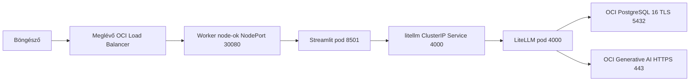

# Streamlit és LiteLLM telepítése OKE-re Cloud Shellből

A telepítés meglévő OKE clustert, OCI Load Balancert, hálózatot, OCI Generative AI szolgáltatást és menedzselt PostgreSQL 16 DB systemet használ. Egy Streamlit-pod és egy LiteLLM-pod indul. A PostgreSQL az OKE-n kívül marad; címe, portja, adatbázisneve, felhasználója, jelszava és CA-tanúsítványa telepítéskor adható meg.



Minden parancs **Cloud Shellben** fut. Nem kell SSH-val belépni a worker node-okra. A műveletekhez OCI-adminisztrátori és cluster-adminisztrációs hozzáférés szükséges; a jogosultságkiosztás az infrastruktúra előfeltétele.

A csomag különálló a VM-es `Applications` csomagtól. Javasolt Git-könyvtára: **`KubernetesApplications`**. A két csomag `.env`, `settings.env`, `local` és credential fájljait ne másold össze. Az alapértelmezett külön DB/user `litellm_k8s`. Ugyanaz az OCI DB system használható, de a VM-es LiteLLM adatbázisát ne add meg célként: legyen külön alkalmazás-adatbázis, külön felhasználóval.

## 1 Az infrastruktúra ellenőrzése

**OCI Console → OKE → Clusters → saját cluster:**

1. Az állapot legyen **Active**, managed worker node-okkal, `amd64` architektúrával. Ebben a workshopban Kubernetes **v1.37.1** a célkörnyezet.
2. Jegyezd fel a cluster **OCID-ját**, régióját, VCN-jét és a **privát API-végpontját**.
3. A node poolban legyen szabad kapacitás az app 250m CPU / 256Mi és a LiteLLM 500m CPU / 1Gi erőforrásigényére. A LiteLLM és a migráció memóriahatára 4Gi, az appé 1Gi; ez induló workshop-beállítás.
4. Legyen meg a meglévő OCI Load Balancer neve, a böngészőből elérhető címe és az LB-hez rendelt NSG. Normál OCI Load Balancert, HTTP/HTTPS listenert feltételezünk.
5. **Databases → PostgreSQL → DB Systems → saját DB:** állapota **Active**, PostgreSQL-verziója **16**. Másold ki a **primary FQDN**-t és töltsd le a **CA certificate** fájlt. A reader endpoint nem megfelelő.
6. Legyen meg a DB-admin felhasználó neve és jelszava. Ha már létezik az alkalmazás külön DB-je és felhasználója, azok adatai is kellenek. A PostgreSQL-admin és az OCI Console-felhasználó két külön hitelesítés.
7. Kérd el a használható GenAI-modell OCI-azonosítóját, régióját és inference compartment OCID-ját.

A node-oknak el kell érniük az OCIR-t a képek letöltéséhez; a podoknak a PostgreSQL-t és a GenAI-t. A buildhez a Cloud Shellből PyPI, Debian csomagtárak, a konténer-alapkép registryje és a Prisma letöltési végpontjai is legyenek elérhetők.

## 2 Cloud Shell architektúra és a forrás letöltése

A Cloud Shellben:

```bash
uname -m
```

**Elvárt:** `x86_64`. Ha `aarch64`, Cloud Shell **Actions → Architecture → x86_64 → Confirm and Restart**. Az AMD64 worker node-okhoz AMD64 képet készítünk.

**Cloud Shell → Network → Public Network**, majd:

```bash
cd ~
git clone https://github.com/norbsch/ocitestdrivebudapest.git
cd ~/ocitestdrivebudapest/KubernetesApplications
ls app proxy runtime tools scripts templates
podman --version
python3 --version
df -h "$HOME" /tmp
```

**Előfeltétel az oktatónak:** a repo legyen nyilvánosan olvasható, és ezt a külön csomagot előzetesen másolja be és töltse fel `KubernetesApplications` néven. A klónozás nem kér GitHub-felhasználónevet, tokent vagy SSH-kulcsot. Meglévő klónnál új klónozás helyett a repo gyökerében `git pull --ff-only origin main` kell; helyi módosításnál állj meg és egyeztesd a frissítést.

A Cloud Shell jelenleg Podmant biztosít, a `docker` név kompatibilitási wrapper lehet. Ezért a buildscript közvetlenül **Podmant** használ. A home tárhelye korlátozott; tárhelyhiba esetén ne töröld más munkád képeit vagy fájljait ellenőrzés nélkül. [Cloud Shell és architektúra](https://docs.oracle.com/en-us/iaas/Content/API/Concepts/cloudshellintro.htm)

## 3 OCIR repositoryk és Auth Token

**OCI Console → Container Registry**, a cluster régiójában és a saját compartmentben:

1. **Create repository**, Standard repository, **Private** hozzáférés.
2. Név: `oci-ai-k8s-streamlit`.
3. Ugyanígy hozz létre egy második private repositoryt: `oci-ai-k8s-litellm`.
4. A repo részleteinél jegyezd fel a tenancy **namespace** értékét. Ez az Object Storage namespace, nem a compartment neve vagy a tenancy OCID-ja.

**Profil → My profile / User settings → Auth tokens → Generate token:** név például `oci-ai-k8s-ocir`. A tokent mentsd jelszókezelőbe; csak létrehozáskor látszik. Nem azonos az OCI API privát kulccsal és nem a Console-jelszó.

OCIR-felhasználónév: saját OCI-felhasználó, szükség esetén identity domainnel, például `Default/user@example.com`. A script elé teszi a tenancy namespace-t. A pontos domain/felhasználó formátumot a saját OCI-profilod alapján töltsd ki. [OCIR és imagePullSecret](https://docs.oracle.com/en-us/iaas/Content/Registry/Tasks/registrypullingimagesfromocir.htm)

## 4 A konfiguráció kitöltése

```bash
cd ~/ocitestdrivebudapest/KubernetesApplications
umask 077
mkdir -p local
chmod 700 local
test -f settings.env || cp templates/settings.env.example settings.env
chmod 600 settings.env
nano settings.env
```

| Mező | Kitöltés |
| --- | --- |
| `KUBE_CONTEXT` | A 7. pontban kapott `kubectl config current-context` érték. Addig ez az egy mező lehet helyőrző. |
| `NAMESPACE` | Külön név, alapból `oci-ai-k8s`. Meglévő idegen namespace-t nem vesz át a script. |
| `REGISTRY` | Frankfurt esetén `fra.ocir.io`, protokoll nélkül. |
| `OCIR_NAMESPACE`, `OCIR_USERNAME` | A 3. pont adatai; a username elé ne írd a tenancy namespace-t. |
| `APP_REPOSITORY`, `PROXY_REPOSITORY` | A 3. pontban létrehozott két repository neve. |
| `IMAGE_TAG` | Első telepítéshez `workshop-v1`. Új képtartalomhoz új taget használj. |
| `NODE_PORT` | Alapból `30080`; a clusterben legyen szabad. Más értéknél az LB és a hálózati szabályok is ezt használják. |
| `APP_PUBLIC_HOST`, `APP_PUBLIC_PORT` | A böngészőből használt LB hostname/IP és listener portja, alapból `8080`. Hostnév protokoll, útvonal és port nélkül. Ezt a Streamlit külső címként is megkapja; a pod saját portja továbbra is `8501`. |
| `DB_HOST`, `DB_PORT` | Saját PostgreSQL primary FQDN, protokoll nélkül; port alapból `5432`. FQDN-t használj IP helyett a tanúsítvány-ellenőrzéshez. |
| `DB_NAME`, `DB_USER` | Alapból mindkettő `litellm_k8s`. Már előkészített DB-nél annak valódi neve. |
| `DB_ADMIN` | PostgreSQL adminfelhasználó neve; a jelszava nem kerül ebbe a fájlba. |
| `OCI_REGION`, `OCI_COMPARTMENT_ID`, `OCI_MODEL_ID` | A GenAI adatai. A GenAI-régió eltérhet a cluster régiójától. |
| `OCI_USER`, `OCI_TENANCY`, `OCI_FINGERPRINT` | Az 5. pont OCI API-kulcsának adatai. |

A DB-nevekhez és felhasználókhoz egyszerű kisbetűs nevet használj: betű, szám, aláhúzás, legfeljebb 63 karakter. Jelszót ne írj a `settings.env` fájlba. Nem shellscript: ne használj `export` előtagot, idézőjeleket vagy az `=` körül szóközt. Nano mentés: Ctrl+O → Enter → Ctrl+X.

A modell appban használt aliasa `oci-cohere`. A `proxy/config.yaml` demóára `0.00000156` USD/karakter inputra és outputra; az oktató erősítse meg a használható árat, szükség esetén itt írd át:

```bash
nano proxy/config.yaml
```

## 5 OCI API-kulcs és PostgreSQL CA feltöltése

Ha még nincs saját OCI API-kulcsod: **Profil → My profile / User settings → API keys → Add API key → Generate API key pair**. Töltsd le a privát kulcsot, majd **Add**. A Configuration File Preview mezőiből másold át a tenancy, user és fingerprint adatot a `settings.env` megfelelő mezőjébe. A GenAI-híváshoz ezt a kulcsot kapja a LiteLLM; a Cloud Shell OKE-hitelesítése ettől külön működik.

**Cloud Shell Upload** menüjével töltsd fel külön az API privát kulcsot és az 1. pont saját DB systeméből letöltött CA-t a home könyvtárba. A CA kiterjesztése lehet `.pub`; ettől nem SSH-kulcs.

```bash
ls -lt "$HOME"
```

A helyőrzőket a saját feltöltött fájlok **teljes nevére** cseréld. Az idézőjelek maradjanak:

```bash
cd ~/ocitestdrivebudapest/KubernetesApplications
mv -i "$HOME/REPLACE_API_PRIVATE_KEY_FILENAME" local/oci-api-key.pem
mv -i "$HOME/REPLACE_POSTGRES_CA_FILENAME" local/postgres-ca.pem
chmod 600 local/oci-api-key.pem local/postgres-ca.pem
ls -l local/oci-api-key.pem local/postgres-ca.pem
```

Meglévő megfelelő célfájlnál a hozzá tartozó `mv` sort hagyd ki. Ne másolj ide SSH-kulcsot, kubeconfigot vagy VM-es `proxy.env` fájlt. A build `.dockerignore` fájlja csak az app, proxy-requirements és runtime forrásfájlokat engedi a buildkörnyezetbe; credentialt nem másolunk a képekbe.

## 6 A két konténerkép buildje és feltöltése

A Cloud Shell hálózata itt **Public Network** legyen, vagy olyan privát hálózat, amelyről az összes buildfüggőség letölthető. A `KUBE_CONTEXT` mező ennél a buildlépésnél még maradhat helyőrző; a 7. pontban töltjük ki. A buildhez az OKE API elérése nem szükséges.

```bash
cd ~/ocitestdrivebudapest/KubernetesApplications
python3 tools/workshop.py build-push
```

A script rejtve az **OCIR Auth Tokent** kéri. Készít két `linux/amd64` képet a mellékelt Dockerfile-okból, ellenőrzi az architektúrát, és feltölti a saját OCIR repositorykba. A proxy-kép a VM-es csomaggal egyező **LiteLLM 1.108.4** és **Prisma 0.15.0** verziót használja; a Prisma-kliens a build során készül el. Az app Streamlit **1.67.0**.

**Elvárt:** `PASS: ket kep az OCIR-ben.` A `local/registry-auth.json` titkos OCIR-hitelesítést tartalmaz; ne listázd a tartalmát és ne tedd Gitbe. Ebből készül a Kubernetes imagePullSecret.

## 7 OKE-hozzáférés privát Cloud Shell hálózatról

**Cloud Shell → Network:** válaszd a cluster VCN-jét elérő **Private Network Access** definíciót. A Cloud Shell és a privát OKE API között engedélyezett **TCP/6443** szükséges; a VM-ek SSH-jához használt TCP/22 nem helyettesíti.

**OCI Console → OKE → Clusters → saját cluster → Actions → Access cluster:** a saját cluster OCID-jával és régiójával futtasd a `create-kubeconfig` parancsot, **`--kube-endpoint PRIVATE_ENDPOINT`** beállítással. Példasablon, a két helyőrzőt cseréld ki:

```bash
mkdir -p "$HOME/.kube"
oci ce cluster create-kubeconfig --cluster-id REPLACE_CLUSTER_OCID --file "$HOME/.kube/config" --region REPLACE_CLUSTER_REGION --token-version 2.0.0 --kube-endpoint PRIVATE_ENDPOINT
export KUBECONFIG="$HOME/.kube/config"
chmod 600 "$HOME/.kube/config"
kubectl config current-context
kubectl get nodes --request-timeout=10s -L kubernetes.io/arch,node.kubernetes.io/instance-type
```

**Elvárt:** a saját context és legalább egy Ready/amd64 node. A `localhost:8080` hiányzó/hibás kubeconfigra utal. A publikus API-címre érkező timeout esetén ne ugyanazt ismételd: ellenőrizd a Cloud Shell aktív hálózatát és a kiválasztott API-végpontot.

A kapott contextet írd a `settings.env` `KUBE_CONTEXT` mezőjébe. A script ellenőrzi az aktív context egyezését, és minden Kubernetes-művelethez explicit contextet és namespace-t ad meg. A kubeconfig fájl tartalmát ne másold a repóba. Új sessionben ismét válaszd ki a privát hálózatot. [Cloud Shell privát hálózat](https://docs.oracle.com/en-us/iaas/Content/API/Concepts/cloudshellintro_topic-Cloud_Shell_Networking.htm)

## 8 Hálózati engedélyek az alkalmazásoknak

A saját infrastruktúrában ellenőrizd a következő kapcsolatokat. A megfelelő NSG-k ténylegesen legyenek a cél-erőforrásokhoz rendelve.

| Forrás → cél | Szükséges kapcsolat |
| --- | --- |
| Cloud Shell → privát OKE API | TCP/6443 |
| Worker node-ok → OCIR | HTTPS/443, képletöltés |
| LiteLLM pod → GenAI | HTTPS/443 |
| LiteLLM és DB-előkészítő pod → PostgreSQL | TCP/5432, illetve a saját `DB_PORT`, TLS |
| Meglévő OCI LB → mindegyik használható worker node | TCP/30080, illetve a választott `NODE_PORT` |
| Böngésző → meglévő LB listener | A kiválasztott HTTP/HTTPS listener portja |

**A PostgreSQL forrásengedélyét ne a régi LiteLLM VM IP-jére állítsd.** OKE-n a DB által látott forrás a CNI/SNAT-beállítástól függően node- vagy podcím lehet. A kollégád a cluster hálózati típusához tartozó worker/pod NSG-t vagy megfelelő privát subnet CIDR-t engedélyezze a DB NSG-jében; a forrásoldali egress és az útvonal is kell. Ugyanabban a VCN-ben sem ad automatikusan hozzáférést a subnet neve. A 10. pont Jobja a tényleges podhálózatból tesztel.

**Az LB → NodePort kapcsolathoz:** az LB NSG-jében stateful egress TCP a worker node-ok privát címeire a választott NodePorton; a worker node-okhoz rendelt NSG-ben stateful ingress ugyanarra a portra az LB NSG-jéből. Source port: All. A meglévő node↔pod és node↔node clusterforgalmat a NodePort cluster-szintű továbbításához is meg kell őrizni. NetworkPolicy használata esetén a DNS-t, app → LiteLLM-et, a DB-t és a GenAI-t is engedni kell; a csomag nem írja felül a cluster meglévő hálózati szabályait.

## 9 Manifestek és Kubernetes Secretek előkészítése

Ha a buildhez Public Networkre váltottál, most állj vissza a 7. pontban használt privát hálózatra.

```bash
cd ~/ocitestdrivebudapest/KubernetesApplications
python3 tools/workshop.py render
python3 tools/workshop.py check
python3 tools/workshop.py prepare
```

A `local/rendered/*.json` fájlok natív Kubernetes-manifestek, `kubectl` által elfogadott JSON formátumban. Átnézhetők; nem tartalmaznak jelszót vagy kulcsot. A script ezeket az erőforrásokat dependency sorrendben alkalmazza, ezért ne futtass kézzel egyszerre `kubectl apply -f local/rendered/` parancsot.

A `prepare` ellenőrzi az API-kulcs fingerprintjét és a CA-fájl olvashatóságát. Rejtve, kétszer kéri az **alkalmazás DB-felhasználójának jelszavát**. Új DB-usernél válassz új jelszót, meglévőnél annak jelenlegi jelszavát add meg.

Létrejön a külön namespace, három ConfigMap és három Secret:

| Erőforrás | Tartalom / felhasználó |
| --- | --- |
| `workshop-config` ConfigMap | Nem titkos DB- és OCI-paraméterek |
| `litellm-config` ConfigMap | Modell- és árkonfiguráció |
| `postgres-ca` ConfigMap | Nyilvános DB CA-tanúsítvány |
| `litellm-auth` Secret | DB-jelszó, generált LiteLLM master/salt és UI-hitelesítés; csak a proxy és DB-Jobok kapják |
| `oci-api-key` Secret | OCI API privát kulcs; az app nem kapja meg |
| `ocir-pull` Secret | Képletöltési hitelesítés |

A script a generált adatokat a védett `local/credentials.json` fájlban is megőrzi. Újrafuttatáskor nem cseréli le a master/salt kulcsot és a DB-jelszót. Eltérő meglévő Secret esetén megáll. A `local` könyvtárról készíts védett mentést; elvesztésekor ne generálj vakon új kulcsokat. A Kubernetes Secret hozzáférését a cluster jogosultságai szabályozzák; a base64 kódolás önmagában nem titkosítás.

**Elvárt:** `PASS: namespace, ConfigMapek es Secretek elokeszitve.` Ekkor még nincs alkalmazástelepítés és DB-módosítás.

## 10 PostgreSQL előkészítése és tesztje a podhálózatból

Ha a `settings.env` szerinti külön adatbázist és DB-felhasználót még nem hoztad létre:

```bash
python3 tools/workshop.py init-db
```

A script rejtve kéri a `DB_ADMIN` **PostgreSQL-jelszavát**. Rövid életű `db-admin-once` Secretet és DB-admin Jobot készít. A Job csak a hiányzó szerepkört/adatbázist hozza létre, a DB tulajdonosa a megadott alkalmazásfelhasználó lesz. Kezeli az ehhez szükséges átmeneti `SET ROLE` jogosultságot, majd visszaállítja azt. Meglévő DB-t, szerepkört vagy jelszót nem ír felül, más tulajdonosnál megáll.

A DB-admin jelszava nem kerül helyi fájlba. A művelet végén a script eltávolítja az admin Jobot és Secretet. A parancsot hagyd lefutni; kapcsolatvesztés esetén a guide 17. pontja szerint ellenőrizd az átmeneti erőforrásokat.

Ha a külön DB és user már készen van, az `init-db` sort hagyd ki. **Mindkét esetben kötelező a következő ellenőrzés:**

```bash
python3 tools/workshop.py prepare-db
```

A `db-check-db` Job kizárólag olvas: a megadott alkalmazásfelhasználóval, CA-lánc- és FQDN-ellenőrzéssel (`sslmode=verify-full`) kapcsolódik a DB-hez. Ellenőrzi a PostgreSQL 16 verziót, a megfelelő DB/user azonosságot, az aktív TLS-t és a `public` schema `CREATE` jogát.

```bash
kubectl -n oci-ai-k8s logs job/db-check-db
```

**Elvárt:** `PASS: alkalmazas DB-kapcsolat, PostgreSQL 16, verify-full TLS es schema CREATE jog.` Csak ezután folytasd. A LiteLLM saját táblái még nem szükségesek; azokat a következő pont migrációs Jobja hozza létre.

Ha módosítottad a `NAMESPACE` értékét, a guide minden kézi `kubectl -n oci-ai-k8s` parancsában is a saját nevedet használd. A Python-telepítő ezt automatikusan a konfigurációból olvassa.

## 11 LiteLLM és Streamlit telepítése egy script futtatásával

```bash
bash scripts/install.sh
```

A script ismét ellenőrzi a kész PostgreSQL-kapcsolatot, majd:

1. Külön `litellm-migrate` Jobbal lefuttatja a LiteLLM migrációit. Hiba esetén megáll; nincs alkalmazásindítás vagy automatikus Job-újrapróbálás.
2. Elindítja a LiteLLM egyetlen példányát és belső `litellm:4000` Service-ét. A kiszolgáló podon a sémamódosítás tiltott; restartkor nem indul új migráció.
3. Ellenőrzi a DB-migrációk állapotát.
4. Létrehoz egy csak `oci-cohere` modellhez használható virtuális kulcsot, 10 USD kerettel és 10 kérés/perc limittel.
5. A virtuális kulcsot és a generált Streamlit cookie-titkot a `streamlit-auth` Secretbe és a védett `local/streamlit-auth.json` fájlba menti.
6. Elindítja az egyetlen Streamlit-podot és a NodePort Service-t.
7. Ellenőrzi az app health végpontját és az app → LiteLLM readiness kapcsolatot. Nem indít fizetős modellhívást.

A telepítő nem készít OCI Load Balancert, Ingress controllert, VM-et vagy PostgreSQL DB systemet. A serving podok nem kapnak DB-admin-jelszót. A LiteLLM későbbi frissítését a 16. pont szerint végezd; a telepítő élő LiteLLM mellé nem futtat migrációt. [LiteLLM migrációk](https://docs.litellm.ai/docs/proxy/prod)

**Elvárt:** a script végén `PASS: a Kubernetes alkalmazasok keszek.` Ez még nem ellenőrzi az OCI API-kulcs tényleges GenAI-jogosultságát; azt a 14–15. pont modellhívása teszteli.

## 12 Állapot és NodePort teszt

```bash
python3 tools/workshop.py status
python3 tools/workshop.py verify
kubectl get nodes -o wide
```

Elvárt: `litellm` és `streamlit` deployment egy-egy Ready poddal; a LiteLLM Service `ClusterIP`, a Streamlité `NodePort`. Nem várunk `EXTERNAL-IP` címet a Streamlit Service-ben: a böngészős címet a már meglévő OCI LB biztosítja.

Az infrastruktúra gazdája engedje a Cloud Shell hálózatából is a worker node-ok választott NodePortját, ha innen közvetlenül teszteled. Ez külön engedély az LB forrásengedélye mellett. Minden használható worker **aktuális INTERNAL-IP** címével, egyenként:

```bash
curl --fail --connect-timeout 5 --max-time 10 http://REPLACE_WORKER_INTERNAL_IP:30080/_stcore/health
```

**Elvárt:** `ok`. A Service `externalTrafficPolicy: Cluster` beállítást használ, ezért a forgalom a másik node-on futó app-podhoz is továbbítható. Egy app-pod mellett is lehet mindhárom worker LB-backend; `Local` beállításra ne válts. [Kubernetes NodePort](https://kubernetes.io/docs/concepts/services-networking/service/)

## 13 A meglévő OCI Load Balancer kézi bekötése

Ez a lépés a meglévő LB konfigurálása; a telepítőscript nem módosítja azt. **OCI Console → Networking → Load Balancers → a kollégád által biztosított LB.**

1. **Backend sets → Create backend set.** Név: `oci-ai-k8s-backends`; policy: Round robin. Használj külön backend setet a Kuberneteses appnak.
2. Health check protocol: **HTTP**, port: **30080**, URL path: **`/_stcore/health`**, elvárt status: **200**. Más NodePort esetén azt írd a port mezőbe.
3. **Backends → Add backends → IP addresses:** add hozzá minden használható worker aktuális privát IP-jét, port **30080**. Nem a pod IP-jét és nem a Kubernetes ClusterIP-t kell ide írni.
4. Várd meg, hogy a backendek **Healthy** állapotúak legyenek. Hibánál először a 12. pont NodePort-próbája és az LB → worker NSG-szabályok következzenek.
5. **Listeners:** ha van kifejezetten ehhez az apphoz előkészített listener, annak default backend setje legyen `oci-ai-k8s-backends`. Ha az LB már más alkalmazást szolgál ki, ahhoz ne nyúlj: hozz létre külön **HTTP listenert a szabad 8080 porton**, név `oci-ai-k8s-http`, backend set `oci-ai-k8s-backends`. A 80-as port is használható, ha szabad és azt biztosították ehhez az apphoz.
6. A listener címe/portja egyezzen a `settings.env` `APP_PUBLIC_HOST` / `APP_PUBLIC_PORT` értékeivel. A listener idle timeoutja legyen **300 másodperc**. A Streamlit WebSocket-kapcsolatot használ; a meglévő köztes proxyk se blokkolják az Upgrade kapcsolatot.
7. Az LB-hez rendelt NSG-ben engedélyezd a kiválasztott listener portját a workshop résztvevőinek hálózatából. A 8. pont szerinti LB → worker NodePort forgalom is működjön.
8. Böngészőből: `http://REPLACE_LB_ADDRESS:8080`, illetve a ténylegesen választott listener címe. Már biztosított HTTPS listenernél annak `https://...` címét használd.

Az első workshopteszt saját domain és új tanúsítvány nélkül, a meglévő LB HTTP-listenerével végezhető. Privát LB esetén a saját böngésződet futtató gépnek is kell hálózati út az LB-hez; a Cloud Shell elérése ezt nem biztosítja.

**Egyetlen app-podhoz nem kell session affinity.** Több app-példányra skálázás előtt a Streamlit munkameneteinek megfelelő tartós routingot külön meg kell tervezni; a három NodePort-backend önmagában nem garantál podszintű session affinityt. Podcsere után a memóriában tárolt beszélgetés elveszik, a LiteLLM DB-s naplója megmarad.

A kézzel felvett LB-backendek nem követik automatikusan a worker IP-cserét vagy a node pool skálázását. Ilyenkor a backendlistát frissíteni kell. [OCI LB listenerek](https://docs.oracle.com/en-us/iaas/Content/Balance/Tasks/managinglisteners.htm)

## 14 Böngészős modellpróba

1. Nyisd meg az LB kiválasztott listenerének címét.
2. Megjelenik az OCI LiteLLM demó és a chatmező.
3. Küldj egy rövid kérdést, például: `Válaszolj egy szóval: működik?`
4. Ellenőrizd a modellválaszt, a tokenhasználatot, a költséget és az azonosítót.

Ez már **fizetős OCI GenAI-modellhívás**. A modellhez használt OCI API privát kulcs, a DB-jelszó és a LiteLLM master key a böngészőhöz nem kerül. A költség a proxy konfigurált árai szerinti becslés.

## 15 Parancssori modellpróba és a PostgreSQL napló ellenőrzése

Ez opcionális, külön fizetős modellhívás. Akkor futtasd, ha egy konkrét kérés DB-s sorát is ellenőrizni szeretnéd:

```bash
python3 tools/workshop.py smoke
```

Elvárt: válasz, tokenhasználat, pozitív `cost_usd`, `litellm_call_id`. Az eredmény a `local/smoke-result.json` fájlba kerül. A script az app virtuális kulcsát használja, nem a master keyt. Sikertelen/bizonytalan kérés után ne indíts automatikus újrapróbálást.

```bash
python3 tools/workshop.py verify-spend
```

Elvárt: ugyanahhoz a call ID-hoz pozitív spend sor a PostgreSQL-ben. Ha még nem látszik, várj egy percet és **csak a `verify-spend` parancsot ismételd**. Ez nem indít új modellhívást. A DB-ellenőrzés közvetlen TLS-kapcsolattal olvas a proxy-podból.

## 16 Frissítés és újraindítás

A sémamigráció módosíthatja a táblákat. LiteLLM-verzióváltás előtt a DB gazdájával legyen egyeztetett mentés és visszaállítás; egy Deployment-image visszacserélése nem állítja vissza a DB sémáját.

1. A saját forrásmódosítások után válassz új `IMAGE_TAG` értéket, például `workshop-v2`. Build/push a 6. pont szerint; ha hálózatot váltottál, utána vissza a privát OKE-elérésre.
2. Ellenőrizd újra a contextet a 7. pont szerint.
3. Állítsd le az appot, majd a LiteLLM-et, és várd meg a podok leállását:

```bash
kubectl -n oci-ai-k8s scale deployment/streamlit --replicas=0
kubectl -n oci-ai-k8s wait --for=delete pod -l app.kubernetes.io/name=streamlit --timeout=120s
kubectl -n oci-ai-k8s scale deployment/litellm --replicas=0
kubectl -n oci-ai-k8s wait --for=delete pod -l app.kubernetes.io/name=litellm --timeout=120s
python3 tools/workshop.py prepare
bash scripts/install.sh
```

A `prepare` megőrzi a DB-jelszót, master/salt és appkulcsot; új kulcsot nem generál. A telepítés újrafuttatja a migrációs Jobot és visszaállítja az egy-egy példányt. A frissítés kieséssel jár; az egy példányos workshop nem biztosít folyamatos rendelkezésre állást.

Csak pod-újraindítás, változatlan képpel és DB-sémával:

```bash
kubectl -n oci-ai-k8s rollout restart deployment/litellm
kubectl -n oci-ai-k8s rollout status deployment/litellm --timeout=900s
kubectl -n oci-ai-k8s rollout restart deployment/streamlit
python3 tools/workshop.py verify
```

## 17 Hibakeresés

```bash
python3 tools/workshop.py status
kubectl -n oci-ai-k8s get events --sort-by=.lastTimestamp
kubectl -n oci-ai-k8s logs deployment/litellm --tail=80
kubectl -n oci-ai-k8s logs deployment/streamlit --tail=80
kubectl -n oci-ai-k8s logs job/db-check-db
kubectl -n oci-ai-k8s logs job/litellm-migrate
```

A naplót helyben nézd meg; credentialt, teljes Secretet, kubeconfigot és teljes alkalmazásnaplót ne küldj chatbe vagy Gitbe.

| Jelenség | Teendő |
| --- | --- |
| `localhost:8080` | Saját kubeconfig létrehozása és helyes `KUBECONFIG`, 7. pont. |
| OKE API timeout | Aktív privát Cloud Shell hálózat, privát API-végpont, TCP/6443, útvonal. |
| `ImagePullBackOff` | Az OCIR image/tag tényleg létezik-e; registry namespace/domain/username, Auth Token, `ocir-pull` Secret és node → OCIR elérés. Új tokenhez új `build-push`, majd `prepare`. |
| Buildnél tárhelyhiba | `df -h`, `podman system df`; csak saját, már nem szükséges buildképeket törölj. Ne futtass általános prune parancsot más munkák ellenőrzése nélkül. |
| `Pending` | Pod describe és events: szabad CPU/memória, amd64 node, taint, ResourceQuota, image méret / tárhely. |
| DB timeout | A podhálózatból engedett DB-port, CNI/SNAT szerinti forrás és DNS, nem a régi VM engedélye. |
| DB TLS hiba | Saját primary FQDN és ugyanahhoz a DB systemhez letöltött CA. Ne kapcsold ki a TLS-ellenőrzést. |
| DB auth / schema-joghiba | A mentett alkalmazásjelszó a megadott DB-userhez tartozzon; a DB legyen ennek tulajdonában és a `public` CREATE joga működjön. A DB-admin jelszó ettől különbözik. |
| Hibás DB-jelszó vagy megváltoztatott DB-cél | A csomag nem forgat automatikusan mentett hitelesítőket. Az első kísérlet javításához egyeztess az oktatóval; meglévő futó telepítés `local` állapotát ne töröld. |
| `litellm-migrate` failed | Logs és DB-adminnal egyeztetés; ne használj `db push --accept-data-loss`, migration-reset vagy vak migrate-resolve parancsot. |
| `OOMKilled` | Memóriaigény és nodekapacitás ellenőrzése; a generátorban emeld a megfelelő erőforráshatárt és renderelj újra. |
| LB unhealthy | Backend a worker INTERNAL-IP és a választott NodePort, HTTP health path `/_stcore/health`; LB/node NSG, cluster továbbítás. |
| App megnyílik, de nincs chatkapcsolat | Listener/köztes proxy WebSocket-támogatása, idle timeout, valamint az APP_PUBLIC_HOST/PORT és a tényleges böngészős cím egyezése. A CORS/XSRF védelmet ne kapcsold ki. |
| Modellhívás 401/403 | Appkulcs és modellalias; OCI API user, fingerprint, compartment, modell és meglévő GenAI-hozzáférés. |
| Modellhívás 429 | Virtuális kulcs 10 RPM limitje vagy OCI-kvóta; várj. |
| Nincs spend sor | Aszinkron naplóírás; várj, és csak a DB-t olvasó ellenőrzést ismételd. |

Ha megszakadt az `init-db`: nézd meg a `db-init-db` Jobot. Aktív Jobot ne indíts párhuzamosan; befejezés vagy hiba után a `db-admin-once` Secretet távolítsd el, ha a script takarítása nem tudott lefutni. A Jobot is töröld, ha már nincs rá szükség. Az adminparancs nem fut újra magától.

Ha a virtuális kulcs létrehozása bizonytalanul szakadt meg, a `local/key-create-attempt.json` szándékosan blokkolja a vak újrapróbálást. A LiteLLM kulcslistájában ellenőrizd a namespace-hez tartozó `...-streamlit` aliast, és egyeztesd a helyreállítást. A master/salt kulcsot ne generáld újra.

## 18 A workshop eltávolítása

Csak a saját namespace-ed és a hozzá tartozó dedikált LB-listener/backend set eltávolítását végezd. Előbb az OCI Console-ban vedd ki az ehhez a csomaghoz felvett külön listenert/backend setet, majd:

```bash
kubectl -n oci-ai-k8s get deployments,services,jobs
kubectl delete namespace oci-ai-k8s
```

Ez törli a namespace Kubernetes-erőforrásait, a Secreteket is. A külső PostgreSQL adatait, az OCI Load Balancert és az OCIR képeket nem törli. Ezek életciklusát külön kezeli az infrastruktúra gazdája. A `local` mentés credentialöket tartalmaz; a workshop után a saját titokkezelési rend szerint kezeld.
