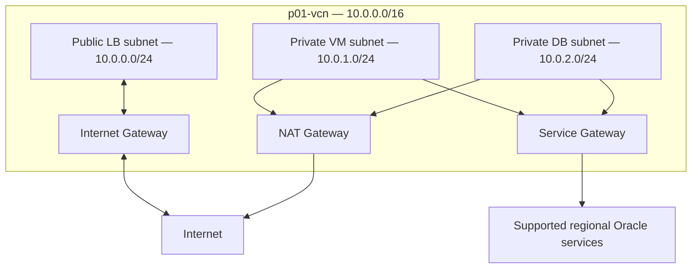

# Network Hands-on Lab

**Project:** OCITestDriveBudapest

## Goal / Estimated time

Create the OCI networking foundation: one VCN, three subnets, three gateways, dedicated route tables, and security lists. Load balancers, VMs, and databases are created in later labs.

**Estimated time:** 35–50 minutes using OCI Console; 15–25 minutes using Terraform after authentication is configured.

> **Training configuration:** The lab allows all protocols within the VCN and all outbound IPv4 traffic. Restrict rules to application requirements before using this design in production.

## Contents

- [Goal / Estimated time](#goal--estimated-time)
- [Before you begin](#before-you-begin)
- [Target configuration](#target-configuration)
- [Option A - Deployment steps for OCI Console](#option-a---deployment-steps-for-oci-console)
- [Option B - Deployment steps for Terraform](#option-b---deployment-steps-for-terraform)
- [Troubleshooting](#troubleshooting)
- [Optional cleanup](#optional-cleanup)
- [Oracle documentation references](#oracle-documentation-references)

## Before you begin

### 1. Confirm the prerequisites

1. Complete the Compartment lab and record the lab compartment OCID.
2. Sign in to the [OCI Console](https://cloud.oracle.com/) and select the instructor's deployment region, normally **Germany Central (Frankfurt)** (`eu-frankfurt-1`). Use the same region for all networking and application resources in the remaining labs.
3. Select your lab compartment whenever a resource form asks for one.
4. Use your assigned attendee prefix in all resource names. Keep the supplied CIDRs unless your instructor specifies different ranges.

Each attendee creates a separate VCN. Matching CIDRs in separate, unconnected lab VCNs are intentional; do not create everyone's subnets in one shared VCN.

**Console navigation:** Open **Networking → Virtual Cloud Networks**, then select your VCN. Related resources may appear under tabs such as **Subnets**, **Gateways**, **Routing**, and **Security**, or in a **Resources** menu. Both layouts are covered below.

### 2. Confirm permissions and capacity

Confirm that your account can create VCNs, subnets, gateways, route tables, and security lists in the lab compartment. Ask the instructor to verify IAM permissions, networking limits, and any applicable gateway charges before the session.

### 3. Choose a deployment option

Choose **Option A - OCI Console** or **Option B - Terraform**. Both options create the target configuration below. Use one option for each lab deployment; do not create the same resources with both options.

Use your assigned attendee prefix in place of `p01`, consistently across all labs. Follow the workshop order: **Compartment → Network → VM → Load Balancer → PostgreSQL → OKE**.

For Option B, follow the two authentication methods in [Prepare the environment and authentication](#2-prepare-the-environment-and-authentication). Keep attendee settings in `terraform.tfvars` and use a separate Terraform directory and state for each lab and attendee.

## Target configuration

### Resource settings

| Resource | Name | IPv4 CIDR | Access | Route table | Security list |
| --- | --- | --- | --- | --- | --- |
| VCN | `p01-vcn` | `10.0.0.0/16` | — | — | — |
| Load balancer subnet | `p01-subnet-public-lb` | `10.0.0.0/24` | Public | `p01-rt-public-lb` | `p01-sl-public-lb` |
| VM subnet | `p01-subnet-private-vm` | `10.0.1.0/24` | Private | `p01-rt-private-vm` | `p01-sl-private-vm` |
| Database subnet | `p01-subnet-private-db` | `10.0.2.0/24` | Private | `p01-rt-private-db` | `p01-sl-private-db` |

All three subnets will be **regional** and **IPv4 only**.

### Gateways and routing

| Gateway | Name | Purpose |
| --- | --- | --- |
| Internet Gateway | `p01-igw` | Internet connectivity for public resources |
| NAT Gateway | `p01-natgw` | Outbound internet connections from private resources |
| Service Gateway | `p01-sgw` | Private access to supported regional Oracle Services Network services |



Arrows show the intended gateway paths. NAT supports connections initiated by private resources and their responses; it does not provide unsolicited inbound internet access. Connections between private IPs inside this VCN use OCI's implicit local routing.

> **Service Gateway scope:** “All `<region>` Services in Oracle Services Network” is a regional service CIDR label maintained by Oracle. It covers supported OSN destinations, not every OCI IP address, another VCN, or every Oracle website. Other internet destinations use the private subnet's NAT default route.

Only the dedicated security list is assigned to each subnet. Default VCN networking objects are left unchanged. The internal ingress CIDR follows `vcn.cidr_block` automatically. The regional service OCID and route destination label are discovered automatically.

This creates **13 managed resources**: one VCN, three gateways, three route tables, three security lists, and three subnets. No load balancer, VM, database, IAM policy, or compartment is created.

## Option A - Deployment steps for OCI Console

### 1. Create the VCN

1. Open **☰ → Networking → Virtual Cloud Networks**.
2. Select the training compartment and select **Create VCN**. Use manual creation; avoid the **VCN with Internet Connectivity** wizard, which creates additional resources automatically.
3. Enter these values:

   | Field | Value |
   | --- | --- |
   | Name | `p01-vcn` |
   | Compartment | Your training compartment |
   | IPv4 CIDR Blocks | `10.0.0.0/16` |
   | Use DNS hostnames in this VCN | Selected |
   | DNS label | `p01vcn` |
   | IPv6 prefixes | Do not assign an IPv6 prefix |

4. Select **Create VCN** and open `p01-vcn`.
5. Wait until its state is **Available**.

**Checkpoint:** The VCN has CIDR `10.0.0.0/16`. OCI creates default networking objects with a VCN; the following steps create dedicated route tables and security lists for this lab.

### 2. Create three security lists

Security lists are associated with **subnets**. Route tables contain routes; security lists contain traffic-allow rules.

For **every ingress and egress rule in this lab**, leave **Stateless** unchecked or switched off. If the Console offers a state selection, choose **Stateful**. Stateful rules track allowed connections and automatically allow their response traffic.

#### 2.1 Public load balancer security list

1. From `p01-vcn`, open **Security → Security Lists**, or **Resources → Security Lists**.
2. Select **Create Security List**.
3. Enter name **`p01-sl-public-lb`** and select your training compartment.
4. Under **Ingress Rules**, add these three rules using **+ Another Ingress Rule** or **Add Ingress Rules**:

   | Source type | Source CIDR | IP protocol | Source port range | Destination port range | Stateless |
   | --- | --- | --- | --- | --- | --- |
   | CIDR | `10.0.0.0/16` | All Protocols | Not applicable | Not applicable | Off |
   | CIDR | `0.0.0.0/0` | TCP | All | `80` | Off |
   | CIDR | `0.0.0.0/0` | TCP | All | `443` | Off |

   For TCP rules, leave the source port field at **All**; if an empty field means All in your form, leave it empty. Set the **destination** port to `80` or `443`. These are two separate rules, not the range `80–443`.

5. Under **Egress Rules**, ensure there is exactly one rule:

   | Destination type | Destination CIDR | IP protocol | Ports | Stateless |
   | --- | --- | --- | --- | --- |
   | CIDR | `0.0.0.0/0` | All Protocols | Not applicable | Off |

6. Remove any extra rules prefilled in this new list that do not match the tables above. If the correct egress rule already exists, keep it without adding a duplicate.
7. Select **Create Security List**.

#### 2.2 Private VM security list

1. Return to **Security Lists** and select **Create Security List**.
2. Enter name **`p01-sl-private-vm`** and select the same compartment.
3. Configure the following rules only:

   | Direction | Source/destination type | Source/destination CIDR | IP protocol | Stateless |
   | --- | --- | --- | --- | --- |
   | Ingress | Source: CIDR | `10.0.0.0/16` | All Protocols | Off |
   | Egress | Destination: CIDR | `0.0.0.0/0` | All Protocols | Off |

4. Select **Create Security List**.

#### 2.3 Private database security list

1. Create another list named **`p01-sl-private-db`**.
2. Use exactly the same rules as the private VM list: stateful ingress from `10.0.0.0/16`, all protocols; stateful egress to `0.0.0.0/0`, all protocols.
3. Select **Create Security List**.

**Checkpoint:** Public list: **3 ingress + 1 egress**. Each private list: **1 ingress + 1 egress**. Every rule is stateful. Do not edit the VCN's default security list.

### 3. Create three route tables

Create the tables without routes first, so they can be selected when creating the subnets. Routes are added after the gateways exist.

1. From `p01-vcn`, open **Routing → Route Tables**, or **Resources → Route Tables**.
2. Select **Create Route Table**.
3. Enter **`p01-rt-public-lb`**, select the training compartment, leave route rules empty, and select **Create Route Table**.
4. Repeat for **`p01-rt-private-vm`**.
5. Repeat for **`p01-rt-private-db`**.

**Checkpoint:** Three custom route tables exist with no explicit rules yet. Leave the default route table unchanged.

### 4. Create the subnets and assign their lists and tables

#### 4.1 Public load balancer subnet

1. Open `p01-vcn` → **Subnets** → **Create Subnet**.
2. Enter the values below. Expand advanced options if needed to find the route table or security list selectors.

   | Field | Value |
   | --- | --- |
   | Name | `p01-subnet-public-lb` |
   | Compartment | Your training compartment |
   | Subnet type | Regional |
   | IPv4 CIDR block | `10.0.0.0/24` |
   | Subnet access | Public subnet |
   | Route table | `p01-rt-public-lb` |
   | DHCP options | Default DHCP options for `p01-vcn` |
   | Use DNS hostnames in this subnet | Selected |
   | DNS label | `publiclb` |
   | Security lists | Only `p01-sl-public-lb` |

3. Remove the default security list from the selection if it is preselected.
4. Select **Create Subnet** and wait for **Available**.

#### 4.2 Private VM subnet

Repeat **Create Subnet**, changing these fields:

| Field | Value |
| --- | --- |
| Name | `p01-subnet-private-vm` |
| IPv4 CIDR block | `10.0.1.0/24` |
| Subnet access | Private subnet |
| Route table | `p01-rt-private-vm` |
| DNS label | `privatevm` |
| Security lists | Only `p01-sl-private-vm` |

Keep the same compartment, regional scope, default DHCP options, and DNS hostname setting. Select **Create Subnet**.

#### 4.3 Private database subnet

Repeat again with these values:

| Field | Value |
| --- | --- |
| Name | `p01-subnet-private-db` |
| IPv4 CIDR block | `10.0.2.0/24` |
| Subnet access | Private subnet |
| Route table | `p01-rt-private-db` |
| DNS label | `privatedb` |
| Security lists | Only `p01-sl-private-db` |

Keep the other settings as above and select **Create Subnet**.

**Checkpoint:** Open each subnet and confirm its access type, CIDR, route table, and associated security list match the [target configuration](#resource-settings). If the creation form did not expose a route table selector, open that subnet → **Actions → Edit** or **Edit**, choose its custom **Route Table**, and save.

### 5. Create the gateways

Create all gateways inside **`p01-vcn`** and the training compartment. They are VCN resources; do not select a subnet for them. Leave optional **Route Table Association** fields unset on the gateways. This lab assigns route tables to subnets.

#### 5.1 Internet Gateway

1. Open `p01-vcn` → **Gateways → Internet Gateways**, or **Resources → Internet Gateway**.
2. Select **Create Internet Gateway**.
3. Enter name **`p01-igw`** and verify the compartment.
4. Select **Create Internet Gateway**.
5. Confirm the gateway is **Available** and enabled. If your form includes **Enable Internet Gateway**, select it.

#### 5.2 NAT Gateway

1. Open **Gateways → NAT Gateways**, or **Resources → NAT Gateways**.
2. Select **Create NAT Gateway**.
3. Enter name **`p01-natgw`** and verify the compartment.
4. Keep **Ephemeral IP Address** selected.
5. Select **Create NAT Gateway**.
6. Confirm the gateway is **Available** and traffic is allowed: **Block Traffic** must be **No** or off.

#### 5.3 Service Gateway

1. Open **Gateways → Service Gateways**, or **Resources → Service Gateways**.
2. Select **Create Service Gateway**.
3. Enter name **`p01-sgw`** and verify the compartment.
4. Under **Services**, select **All `<region>` Services in Oracle Services Network**. Use the actual region label shown by your Console; do not type the placeholder. Select the All Services option rather than the Object Storage-only option.
5. Select **Create Service Gateway**.
6. Confirm the gateway is **Available**, the selected service is enabled, and traffic is allowed.

**Checkpoint:** There is one Internet Gateway, one NAT Gateway, and one Service Gateway in your VCN.

### 6. Add the route rules

#### 6.1 Public subnet route table

1. Open `p01-vcn` → **Routing → Route Tables**, or **Resources → Route Tables**.
2. Open **`p01-rt-public-lb`** and select **Add Route Rules**.
3. Configure:

   | Field | Value |
   | --- | --- |
   | Target type | Internet Gateway |
   | Destination type, if shown | CIDR Block |
   | Destination CIDR block | `0.0.0.0/0` |
   | Target compartment | Your training compartment |
   | Target Internet Gateway | `p01-igw` |

4. Select **Add Route Rules** or save the rule.

#### 6.2 Private VM route table

1. Open **`p01-rt-private-vm`** and select **Add Route Rules**.
2. Add the default route:

   | Field | Value |
   | --- | --- |
   | Target type | NAT Gateway |
   | Destination type, if shown | CIDR Block |
   | Destination CIDR block | `0.0.0.0/0` |
   | Target compartment | Your training compartment |
   | Target NAT Gateway | `p01-natgw` |

3. Add another rule, using **+ Another Route Rule** or by saving and selecting **Add Route Rules** again:

   | Field | Value |
   | --- | --- |
   | Target type | Service Gateway |
   | Destination type, if shown | Service |
   | Destination service | All `<region>` Services in Oracle Services Network |
   | Target compartment | Your training compartment |
   | Target Service Gateway | `p01-sgw` |

4. Save both rules. The destination service label must match the one enabled on the Service Gateway.

#### 6.3 Private database route table

1. Open **`p01-rt-private-db`**.
2. Add the **same two rules** as the private VM table: `0.0.0.0/0` → `p01-natgw`, and All regional OSN Services → `p01-sgw`.
3. Save the rules.

#### Expected final routes

| Route table | Destination type | Destination | Target type | Target |
| --- | --- | --- | --- | --- |
| `p01-rt-public-lb` | CIDR Block | `0.0.0.0/0` | Internet Gateway | `p01-igw` |
| `p01-rt-private-vm` | CIDR Block | `0.0.0.0/0` | NAT Gateway | `p01-natgw` |
| `p01-rt-private-vm` | Service | All regional OSN Services | Service Gateway | `p01-sgw` |
| `p01-rt-private-db` | CIDR Block | `0.0.0.0/0` | NAT Gateway | `p01-natgw` |
| `p01-rt-private-db` | Service | All regional OSN Services | Service Gateway | `p01-sgw` |

The service route takes precedence for matching OSN destinations; other external IPv4 destinations use the NAT route. No manual route for `10.0.0.0/16` is needed for communication between the subnets. Leave the public table with its single Internet Gateway route for this exercise.

### 7. Verify deployment

Complete this checklist in the Console:

- [ ] VCN CIDR is `10.0.0.0/16`.
- [ ] Public LB subnet is regional, public, and uses `10.0.0.0/24`.
- [ ] VM subnet is regional, private, and uses `10.0.1.0/24`.
- [ ] Database subnet is regional, private, and uses `10.0.2.0/24`.
- [ ] All three gateways are available and allow traffic.
- [ ] The Service Gateway enables All regional OSN Services.
- [ ] Each subnet uses its own custom route table and only its intended custom security list.
- [ ] Public route table has **1** rule: default route to the Internet Gateway.
- [ ] Each private route table has **2** rules: default route to NAT and service route to the Service Gateway.
- [ ] Each security list allows ingress from `10.0.0.0/16`, all protocols.
- [ ] Public security list additionally allows TCP destination ports `80` and `443` from `0.0.0.0/0`.
- [ ] Each security list allows egress to `0.0.0.0/0`, all protocols.
- [ ] Every rule has **Stateless = No**.

#### Connectivity expectations for later exercises

These are expected results after the application resources are deployed, not tests of empty subnets:

| Connection | Expected behavior |
| --- | --- |
| Internet → public load balancer on TCP/80 or TCP/443 | Allowed by this network configuration; requires a public load balancer and listener |
| Internet → private VM or database directly | No direct inbound internet path |
| Private VM → internet | Outbound connection through NAT; responses allowed |
| Private VM or database → supported regional OSN endpoint | Uses Service Gateway |
| VM → database private IP | Allowed by the lab's VCN-wide ingress rules |

Applications, listeners, database access settings, operating-system firewalls, and any additional security policies must also permit the connection. A public subnet by itself does not assign a public IP or create a load balancer.

## Option B - Deployment steps for Terraform

Complete **Before you begin** first. This lab has one README for both deployment options. Run all Terraform commands from `Network/terraform/` in your repository checkout.

### 1. Review the Terraform files

All paths in this table are relative to `Network/terraform/`.

| File | Purpose |
| --- | --- |
| `versions.tf` | Defines the supported Terraform and OCI provider versions. |
| `providers.tf` | Configures the OCI region and selected authentication method. |
| `variables.tf` | Declares input parameters, types, and validation rules. |
| `terraform.tfvars.example` | Provides the example lab settings; copy it to `terraform.tfvars`. |
| `terraform.tfvars` | Contains your local attendee settings; created in step 3 and kept out of Git. |
| `main.tf` | Creates the VCN, gateways, route tables, security lists, and subnets. |
| `outputs.tf` | Reports the VCN, subnet, and gateway OCIDs and network settings. |
| `.terraform.lock.hcl` | Records the selected provider version and checksums; created or reused by `terraform init` and committed after review. |

Keep normal lab changes in `terraform.tfvars`; use `variables.tf` to check accepted inputs. Provider version constraints stay in `versions.tf`.

### 2. Prepare the environment and authentication

Use **Terraform 1.5 or later, below 2.0**, as required by `versions.tf`. The OCI provider constraint for this lab is `>= 7.0.0, < 9.0.0`. Terraform installs the provider during initialization. The command examples use Bash, available in OCI Cloud Shell and common Linux/macOS terminals. On Windows, use a compatible shell or adapt the shell syntax.

Choose one of the following authentication methods. In this lab, `auth_method` is the input that sets the OCI provider's `auth` argument. Add the selected values to `terraform.tfvars` in step 3.

#### Local machine (`auth = "APIKey"`)

Install Terraform CLI and configure an OCI API-signing-key profile in `~/.oci/config`. The profile must contain `tenancy`, `user`, `fingerprint`, and `key_file`. Register the matching public key with your OCI user, and keep the private key outside the repository.

```hcl
auth_method         = "APIKey"
config_file_profile = "DEFAULT"
```

Replace `DEFAULT` with your profile name if needed.

#### OCI Cloud Shell (`auth = "InstancePrincipal"`)

Open Cloud Shell from your signed-in OCI Console session. Terraform CLI is already installed; check its version with `terraform version`. Use Cloud Shell's existing authentication environment. You do not need to create an API-signing-key profile in `~/.oci/config` for this method.

```hcl
auth_method         = "InstancePrincipal"
config_file_profile = "DEFAULT"
```

Keep `config_file_profile = "DEFAULT"` in the parameter file with the current repository code: `variables.tf` still requires this input, although the provider passes it as `null` and ignores it when `auth_method = "InstancePrincipal"`. This value does not require a local `DEFAULT` API-key profile in Cloud Shell. Do not omit it unless the variable declaration has also been made optional.

Keep Cloud Shell's preconfigured authentication environment intact. The selected method must have the IAM permissions listed in **Before you begin**. Set `region` to the deployment region containing your lab network; normally `eu-frankfurt-1`.

### 3. Configure the lab parameters

From the repository root, open this lab's Terraform directory and create your local parameter file:

```bash
cd Network/terraform
cp terraform.tfvars.example terraform.tfvars
```

If `terraform.tfvars` already exists, edit that file instead of overwriting it. Set the authentication values from step 2, then review the following lab inputs:

| Parameter | What to enter or check |
| --- | --- |
| `region`, `compartment_id` | Deployment region and compartment OCID from the Compartment lab. |
| `name_prefix` | Your attendee prefix, such as `p01`. |
| `vcn` | VCN name suffix, CIDR, and DNS label; update `vcn.dns_label` to match your prefix. |
| `subnets` | CIDRs, names, DNS labels, public/private access, route table names, and security list names. |
| `gateways` | Gateway names and supported traffic controls. |
| `routing` | Default route destination and regional Oracle Services Network service-name pattern. |
| `security` | Protocols, public ingress ports, source/destination CIDRs, and `stateless = false`. |
| `freeform_tags` | Resource tags. |

All subnet CIDRs must fit inside the VCN and must not overlap. DNS labels start with a letter and contain up to 15 letters/digits. Keep the subnet map keys `public_lb`, `private_vm`, and `private_db` stable when renaming resources; Terraform uses those keys as resource identities.

The internal ingress CIDR follows `vcn.cidr_block`. Oracle service OCIDs and route labels are discovered automatically. The example still contains `gateways.service_blocked`, but `main.tf` does not use it: Service Gateway `block_traffic` is a computed attribute. Do not rely on that parameter to control the Service Gateway.

Changing immutable subnet/DNS/access settings may require replacement. Keep the target lab settings unless the instructor has agreed to a change.

Terraform loads `terraform.tfvars` automatically; no `-var-file` argument is needed. Keep credentials, private keys, local parameter files, state, plans, and `.terraform/` out of Git. Check the applicable `.gitignore` rules; the repository does not provide complete Terraform exclusions for every lab. Commit the Terraform source, sanitized `terraform.tfvars.example`, and reviewed provider lock file.

### 4. Initialize and validate

```bash
terraform init
terraform fmt -recursive
terraform validate
```

`init` installs the provider and creates or reuses `.terraform.lock.hcl`. `fmt` normalizes formatting; it does not change the intended infrastructure. `validate` checks configuration syntax and provider schema. Resolve errors before continuing. Retain the reviewed lock file for repeatable workshop runs; test provider upgrades before changing it.

### 5. Review the execution plan

```bash
terraform plan -out=lab.tfplan
terraform show lab.tfplan
```

For a new deployment, expect **13 to add, 0 to change, 0 to destroy**: one VCN, three gateways, three route tables, three security lists, and three subnets. Verify CIDRs, names, route targets, security rules, and subnet associations. No load balancer, VM, or database is created.

Review the complete plan before applying. Stop if it includes unexpected changes or deletions. If you edit parameters after saving the plan, create and review a new plan.

### 6. Apply the reviewed plan

```bash
terraform apply lab.tfplan
terraform output
```

Applying a saved plan executes its reviewed changes without a second approval prompt. Wait for completion and keep the Terraform state for later updates and cleanup. If an apply only partially succeeds, retain the state, resolve the error, and create a fresh plan.

### 7. Verify deployment

```bash
terraform output -json subnets
```

1. Open **Networking → Virtual Cloud Networks** and locate your VCN.
2. Check the three regional subnets, CIDRs, public/private settings, dedicated route tables, and single custom security list per subnet.
3. Verify the public default route to the Internet Gateway and both private tables' NAT and regional OSN Service Gateway routes.
4. Check that all three gateways allow traffic and every rule is stateful. The public security list has three ingress rules and one egress rule; each private list has one ingress rule and one egress rule.

**Success criteria:** The network matches the checks in [Option A, step 7](#7-verify-deployment). Application connectivity is tested in later labs, after resources and listeners exist.

### 8. Update the configuration

Edit `terraform.tfvars` for routine changes, then repeat steps 4–7 with the same working directory and state. Generate a new plan each time. Avoid editing Terraform-managed resources directly in the Console, and never manage the same resource from two Terraform states.

## Troubleshooting

### Authentication and Terraform

| Symptom | What to check |
| --- | --- |
| APIKey authentication fails | Check the selected profile in `~/.oci/config`, tenancy/user OCIDs, fingerprint, key path, and registered public key. |
| Cloud Shell tries to open `~/.oci/config` | Select `InstancePrincipal` with this lab's authentication input. Confirm the current provider passes `config_file_profile = null` for this mode, and remove any custom profile override that forces local API-key lookup. Keep Cloud Shell's managed authentication environment. |
| Terraform prompts for `config_file_profile` in Cloud Shell | Keep `config_file_profile = "DEFAULT"` in `terraform.tfvars`; the current variable declaration requires a value even though the provider ignores it in this mode. |
| Cloud Shell session authentication fails | Start a fresh signed-in Cloud Shell session and retry with its preconfigured environment. Check IAM permissions if authentication succeeds but requests are denied. |
| Unexpected parameter prompt or undeclared-variable warning | Run commands from this lab's `terraform/` directory and use the exact input names declared in its `variables.tf`. |
| `terraform validate` fails | Check the reported file/line and provider version. Initialize the directory first; use the reviewed `.terraform.lock.hcl`. |
| Apply only partially succeeds | Keep state, resolve the reported error, then create and review a fresh plan before applying. |

### Lab-specific issues

| Symptom | What to check |
| --- | --- |
| Resource or selector entry is missing | Verify region, compartment, VCN, and permissions. Choose the target's compartment in the selector. |
| Private resource cannot reach the internet | Check its subnet's assigned table, the default route to `p01-natgw`, NAT traffic status, and outbound security rules. |
| OSN traffic does not use the Service Gateway | Check the service route in both private tables and that its regional label matches the enabled gateway service. |
| An unexpected port is reachable | Check all security lists associated with the subnet and all NSGs attached to the resource. Their allow rules are additive. Remove an unintended default list association. |
| HTTP/HTTPS fails after deploying a load balancer | Verify public IP, listener, backend health, destination port rules, and the public subnet's Internet Gateway route. |
| SSH from your laptop fails | This lab does not allow inbound internet SSH or provide a private access service. Follow the instructor's separate Bastion or private connectivity exercise. |
| Ping to an internet destination fails | The public list does not allow unsolicited internet ICMP ingress, and remote systems can block ping. Use the appropriate application protocol for testing. |
| `Value for unconfigurable attribute` for Service Gateway `block_traffic` | Remove the `block_traffic = var.gateways.service_blocked` assignment from `oci_core_service_gateway.lab`. Oracle exposes this as a computed attribute, not a configurable argument. Keep any remaining parameter-file fields aligned with the actual source. |
| Unexpected resource replacements | Check immutable subnet/DNS/access settings and review changes before apply. |

If you selected the wrong route table, open the subnet → **Actions → Edit** or **Edit**, change **Route Table**, and save. To fix security list associations, open the subnet's **Security Lists** view and use its association controls; keep the intended custom list associated.

## Optional cleanup

Remove resources created by later labs before deleting their shared network. Use the same deployment option that created each resource.

### Option A - OCI Console

1. Delete dependent load balancers, VMs, databases, OKE resources, and private endpoints. Follow their cleanup steps for storage and backups.
2. Delete the three lab subnets.
3. Remove rules from the three custom route tables, then delete those tables.
4. Delete the three custom security lists.
5. Delete `p01-sgw`, `p01-natgw`, and `p01-igw` after removing route references.
6. Delete `p01-vcn`; OCI handles its remaining default network objects.

Remove only resources belonging to your attendee VCN. If OCI reports a dependency, inspect and remove it before retrying.

### Option B - Terraform

From `Network/terraform/`, use the original state and parameter file. Create a cleanup plan:

```bash
terraform plan -destroy -out=cleanup.tfplan
terraform show cleanup.tfplan
```

Confirm the plan removes only the 13 network resources in this lab's state. Remove all later-lab dependencies first. Terraform orders removal of resources it owns; it cannot remove dependencies owned by other labs.

After reviewing the plan, apply it:

```bash
terraform apply cleanup.tfplan
```

Keep Terraform state until cleanup is confirmed. Delete shared network resources and the compartment only after all dependent labs are finished.

## Oracle documentation references

Console labels can change. These official references explain the corresponding tasks:

- [Creating a VCN](https://docs.oracle.com/en-us/iaas/Content/Network/Tasks/create_vcn.htm)
- [Creating a subnet](https://docs.oracle.com/en-us/iaas/Content/Network/Tasks/create_subnet.htm)
- [Creating a security list](https://docs.oracle.com/en-us/iaas/Content/Network/Concepts/creating-securitylist.htm)
- [Security rules and stateful behavior](https://docs.oracle.com/en-us/iaas/Content/Network/Concepts/securityrules.htm)
- [Creating a VCN route table](https://docs.oracle.com/en-us/iaas/Content/Network/Tasks/create-routetable.htm)
- [Changing a subnet's route table](https://docs.oracle.com/en-us/iaas/Content/Network/Tasks/subnet-change-routetable.htm)
- [Creating an Internet Gateway](https://docs.oracle.com/en-us/iaas/Content/Network/Tasks/create-ig.htm)
- [Creating a NAT Gateway](https://docs.oracle.com/en-us/iaas/Content/Network/Tasks/nat-create.htm)
- [Creating a Service Gateway](https://docs.oracle.com/en-us/iaas/Content/Network/Tasks/create-sgw.htm)
- [Service Gateway scope and routing](https://docs.oracle.com/en-us/iaas/Content/Network/Tasks/servicegateway.htm)
- [OCI Terraform provider configuration](https://docs.oracle.com/en-us/iaas/Content/dev/terraform/configuring.htm)
- [VCN resource](https://docs.oracle.com/en-us/iaas/tools/terraform-provider-oci/latest/docs/r/core_vcn.html)
- [Subnet resource](https://docs.oracle.com/en-us/iaas/tools/terraform-provider-oci/latest/docs/r/core_subnet.html)
- [Route table resource](https://docs.oracle.com/en-us/iaas/tools/terraform-provider-oci/latest/docs/r/core_route_table.html)
- [Security list resource](https://docs.oracle.com/en-us/iaas/tools/terraform-provider-oci/latest/docs/r/core_security_list.html)
- [Regional service discovery](https://docs.oracle.com/en-us/iaas/tools/terraform-provider-oci/latest/docs/d/core_services.html)
- [Service Gateway resource](https://docs.oracle.com/en-us/iaas/tools/terraform-provider-oci/latest/docs/r/core_service_gateway.html)
- [Using OCI Cloud Shell](https://docs.oracle.com/en-us/iaas/Content/API/Concepts/devcloudshellgettingstarted.htm)
- [OCI SDK and CLI configuration file](https://docs.oracle.com/en-us/iaas/Content/API/Concepts/sdkconfig.htm)
