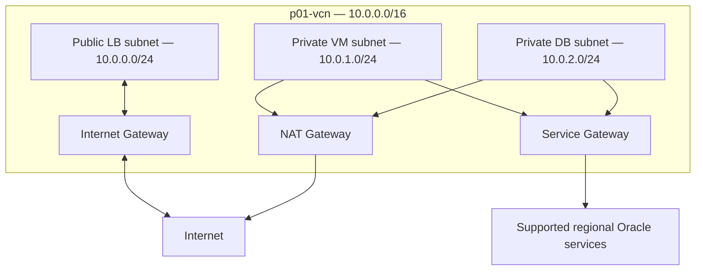

# OCI Networking Hands-on Lab

Build a three-subnet network in the **Oracle Cloud Infrastructure (OCI) Console** for a public load balancer, private virtual machines, and a private database.

**Project:** OCITestDriveBudapest  
**Estimated time:** 35–50 minutes  
**Interface:** OCI Console; no CLI or Terraform required  
**Documentation checked:** 15 November 2026

This lab creates the networking foundation. Creating the load balancer, compute instances, and database is outside its scope.

> **Training configuration:** This exercise deliberately allows all protocols within the VCN and all outbound IPv4 traffic, as required for the workshop. Before using this design in production, restrict access to the sources, destinations, and ports required by each application tier.

## Contents

- [Before you begin](#before-you-begin)
- [Target configuration](#target-configuration)
- [1. Create the VCN](#1-create-the-vcn)
- [2. Create three security lists](#2-create-three-security-lists)
- [3. Create three route tables](#3-create-three-route-tables)
- [4. Create the subnets and assign their lists and tables](#4-create-the-subnets-and-assign-their-lists-and-tables)
- [5. Create the gateways](#5-create-the-gateways)
- [6. Add the route rules](#6-add-the-route-rules)
- [7. Verify your configuration](#7-verify-your-configuration)
- [Troubleshooting](#troubleshooting)
- [Optional cleanup](#optional-cleanup)
- [Oracle documentation](#oracle-documentation)

## Before you begin

1. Sign in to the [OCI Console](https://cloud.oracle.com/).
2. Select the **region** specified by your instructor. Keep that region throughout the lab.
3. Select the instructor-provided **compartment** whenever a resource form asks for one.
4. Confirm that your account can create VCNs, subnets, gateways, route tables, and security lists in that compartment. Your instructor or tenancy administrator should arrange permissions before the session.
5. Choose a short participant identifier, such as `p01`. Replace **every occurrence of `p01`** in resource names below with your identifier. Keep the IP ranges exactly as shown.

Each participant should create a separate VCN. Matching CIDRs in these separate, unconnected lab VCNs are intentional; do not create everyone's subnets in one shared VCN.

**Console navigation:** Open **☰ → Networking → Virtual Cloud Networks**, then select your VCN. Depending on the Console layout, related resources appear under tabs such as **Subnets**, **Gateways**, **Routing**, and **Security**, or in a **Resources** menu. Both layouts are covered below.

## Target configuration

### Network and subnet assignments

| Resource | Name | IPv4 CIDR | Access | Route table | Security list |
| --- | --- | --- | --- | --- | --- |
| VCN | `p01-vcn` | `10.0.0.0/16` | — | — | — |
| Load balancer subnet | `p01-subnet-public-lb` | `10.0.0.0/24` | Public | `p01-rt-public-lb` | `p01-sl-public-lb` |
| VM subnet | `p01-subnet-private-vm` | `10.0.1.0/24` | Private | `p01-rt-private-vm` | `p01-sl-private-vm` |
| Database subnet | `p01-subnet-private-db` | `10.0.2.0/24` | Private | `p01-rt-private-db` | `p01-sl-private-db` |

All three subnets will be **regional** and **IPv4 only**.

### Gateways and routing

| Gateway | Name | Purpose |
| --- | --- | --- |
| Internet Gateway | `p01-igw` | Internet connectivity for public resources |
| NAT Gateway | `p01-natgw` | Outbound internet connections from private resources |
| Service Gateway | `p01-sgw` | Private access to supported regional Oracle Services Network services |

Arrows show the intended gateway paths. NAT supports connections initiated by private resources and their responses; it does not provide unsolicited inbound internet access. Connections between private IPs inside this VCN use OCI's implicit local routing.

> **Service Gateway scope:** “All `<region>` Services in Oracle Services Network” is a regional service CIDR label maintained by Oracle. It covers supported OSN destinations, not every OCI IP address, another VCN, or every Oracle website. Other internet destinations use the private subnet's NAT default route.

## 1. Create the VCN

1. Open **☰ → Networking → Virtual Cloud Networks**.
2. Select the training compartment and click **Create VCN**. Use manual creation; avoid the **VCN with Internet Connectivity** wizard, which creates additional resources automatically.
3. Enter these values:

   | Field | Value |
   | --- | --- |
   | Name | `p01-vcn` |
   | Compartment | Your training compartment |
   | IPv4 CIDR Blocks | `10.0.0.0/16` |
   | Use DNS hostnames in this VCN | Selected |
   | DNS label | `p01vcn` |
   | IPv6 prefixes | Do not assign an IPv6 prefix |

4. Click **Create VCN** and open `p01-vcn`.
5. Wait until its state is **Available**.

**Checkpoint:** The VCN has CIDR `10.0.0.0/16`. OCI creates default networking objects with a VCN; the following steps create dedicated route tables and security lists for this lab.

## 2. Create three security lists

Security lists are associated with **subnets**. Route tables contain routes; security lists contain traffic-allow rules.

For **every ingress and egress rule in this lab**, leave **Stateless** unchecked or switched off. If the Console offers a state selection, choose **Stateful**. Stateful rules track allowed connections and automatically allow their response traffic.

### 2.1 Public load balancer security list

1. From `p01-vcn`, open **Security → Security Lists**, or **Resources → Security Lists**.
2. Click **Create Security List**.
3. Enter name **`p01-sl-public-lb`** and select your training compartment.
4. Under **Ingress Rules**, add these three rules using **+ Another Ingress Rule** or **Add Ingress Rules**:

   | Source type | Source CIDR | IP protocol | Source port range | Destination port range | Stateless |
   | --- | --- | --- | --- | --- | --- |
   | CIDR | `10.0.0.0/16` | All Protocols | Not applicable | Not applicable | Off |
   | CIDR | `0.0.0.0/0` | TCP | All | `80` | Off |
   | CIDR | `0.0.0.0/0` | TCP | All | `443` | Off |

   For TCP rules, leave the source port field at **All**; if an empty field means All in your form, leave it empty. Set the **destination** port to `80` or `443`. These are two separate rules, not the range `80–443`.

5. Under **Egress Rules**, ensure there is exactly one rule:

   | Destination type | Destination CIDR | IP protocol | Ports | Stateless |
   | --- | --- | --- | --- | --- |
   | CIDR | `0.0.0.0/0` | All Protocols | Not applicable | Off |

6. Remove any extra rules prefilled in this new list that do not match the tables above. If the correct egress rule already exists, keep it without adding a duplicate.
7. Click **Create Security List**.

### 2.2 Private VM security list

1. Return to **Security Lists** and click **Create Security List**.
2. Enter name **`p01-sl-private-vm`** and select the same compartment.
3. Configure the following rules only:

   | Direction | Source/destination type | Source/destination CIDR | IP protocol | Stateless |
   | --- | --- | --- | --- | --- |
   | Ingress | Source: CIDR | `10.0.0.0/16` | All Protocols | Off |
   | Egress | Destination: CIDR | `0.0.0.0/0` | All Protocols | Off |

4. Click **Create Security List**.

### 2.3 Private database security list

1. Create another list named **`p01-sl-private-db`**.
2. Use exactly the same rules as the private VM list: stateful ingress from `10.0.0.0/16`, all protocols; stateful egress to `0.0.0.0/0`, all protocols.
3. Click **Create Security List**.

**Checkpoint:** Public list: **3 ingress + 1 egress**. Each private list: **1 ingress + 1 egress**. Every rule is stateful. Do not edit the VCN's default security list.

## 3. Create three route tables

Create the tables without routes first, so they can be selected when creating the subnets. Routes are added after the gateways exist.

1. From `p01-vcn`, open **Routing → Route Tables**, or **Resources → Route Tables**.
2. Click **Create Route Table**.
3. Enter **`p01-rt-public-lb`**, select the training compartment, leave route rules empty, and click **Create Route Table**.
4. Repeat for **`p01-rt-private-vm`**.
5. Repeat for **`p01-rt-private-db`**.

**Checkpoint:** Three custom route tables exist with no explicit rules yet. Leave the default route table unchanged.

## 4. Create the subnets and assign their lists and tables

### 4.1 Public load balancer subnet

1. Open `p01-vcn` → **Subnets** → **Create Subnet**.
2. Enter the values below. Expand advanced options if needed to find the route table or security list selectors.

   | Field | Value |
   | --- | --- |
   | Name | `p01-subnet-public-lb` |
   | Compartment | Your training compartment |
   | Subnet type | Regional |
   | IPv4 CIDR block | `10.0.0.0/24` |
   | Subnet access | Public subnet |
   | Route table | `p01-rt-public-lb` |
   | DHCP options | Default DHCP options for `p01-vcn` |
   | Use DNS hostnames in this subnet | Selected |
   | DNS label | `publiclb` |
   | Security lists | Only `p01-sl-public-lb` |

3. Remove the default security list from the selection if it is preselected.
4. Click **Create Subnet** and wait for **Available**.

### 4.2 Private VM subnet

Repeat **Create Subnet**, changing these fields:

| Field | Value |
| --- | --- |
| Name | `p01-subnet-private-vm` |
| IPv4 CIDR block | `10.0.1.0/24` |
| Subnet access | Private subnet |
| Route table | `p01-rt-private-vm` |
| DNS label | `privatevm` |
| Security lists | Only `p01-sl-private-vm` |

Keep the same compartment, regional scope, default DHCP options, and DNS hostname setting. Click **Create Subnet**.

### 4.3 Private database subnet

Repeat again with these values:

| Field | Value |
| --- | --- |
| Name | `p01-subnet-private-db` |
| IPv4 CIDR block | `10.0.2.0/24` |
| Subnet access | Private subnet |
| Route table | `p01-rt-private-db` |
| DNS label | `privatedb` |
| Security lists | Only `p01-sl-private-db` |

Keep the other settings as above and click **Create Subnet**.

**Checkpoint:** Open each subnet and confirm its access type, CIDR, route table, and associated security list match the [target configuration](#network-and-subnet-assignments). If the creation form did not expose a route table selector, open that subnet → **Actions → Edit** or **Edit**, choose its custom **Route Table**, and save.

## 5. Create the gateways

Create all gateways inside **`p01-vcn`** and the training compartment. They are VCN resources; do not select a subnet for them. Leave optional **Route Table Association** fields unset on the gateways. This lab assigns route tables to subnets.

### 5.1 Internet Gateway

1. Open `p01-vcn` → **Gateways → Internet Gateways**, or **Resources → Internet Gateway**.
2. Click **Create Internet Gateway**.
3. Enter name **`p01-igw`** and verify the compartment.
4. Click **Create Internet Gateway**.
5. Confirm the gateway is **Available** and enabled. If your form includes **Enable Internet Gateway**, select it.

### 5.2 NAT Gateway

1. Open **Gateways → NAT Gateways**, or **Resources → NAT Gateways**.
2. Click **Create NAT Gateway**.
3. Enter name **`p01-natgw`** and verify the compartment.
4. Keep **Ephemeral IP Address** selected.
5. Click **Create NAT Gateway**.
6. Confirm the gateway is **Available** and traffic is allowed: **Block Traffic** must be **No** or off.

### 5.3 Service Gateway

1. Open **Gateways → Service Gateways**, or **Resources → Service Gateways**.
2. Click **Create Service Gateway**.
3. Enter name **`p01-sgw`** and verify the compartment.
4. Under **Services**, select **All `<region>` Services in Oracle Services Network**. Use the actual region label shown by your Console; do not type the placeholder. Select the All Services option rather than the Object Storage-only option.
5. Click **Create Service Gateway**.
6. Confirm the gateway is **Available**, the selected service is enabled, and traffic is allowed.

**Checkpoint:** There is one Internet Gateway, one NAT Gateway, and one Service Gateway in your VCN.

## 6. Add the route rules

### 6.1 Public subnet route table

1. Open `p01-vcn` → **Routing → Route Tables**, or **Resources → Route Tables**.
2. Open **`p01-rt-public-lb`** and click **Add Route Rules**.
3. Configure:

   | Field | Value |
   | --- | --- |
   | Target type | Internet Gateway |
   | Destination type, if shown | CIDR Block |
   | Destination CIDR block | `0.0.0.0/0` |
   | Target compartment | Your training compartment |
   | Target Internet Gateway | `p01-igw` |

4. Click **Add Route Rules** or save the rule.

### 6.2 Private VM route table

1. Open **`p01-rt-private-vm`** and click **Add Route Rules**.
2. Add the default route:

   | Field | Value |
   | --- | --- |
   | Target type | NAT Gateway |
   | Destination type, if shown | CIDR Block |
   | Destination CIDR block | `0.0.0.0/0` |
   | Target compartment | Your training compartment |
   | Target NAT Gateway | `p01-natgw` |

3. Add another rule, using **+ Another Route Rule** or by saving and selecting **Add Route Rules** again:

   | Field | Value |
   | --- | --- |
   | Target type | Service Gateway |
   | Destination type, if shown | Service |
   | Destination service | All `<region>` Services in Oracle Services Network |
   | Target compartment | Your training compartment |
   | Target Service Gateway | `p01-sgw` |

4. Save both rules. The destination service label must match the one enabled on the Service Gateway.

### 6.3 Private database route table

1. Open **`p01-rt-private-db`**.
2. Add the **same two rules** as the private VM table: `0.0.0.0/0` → `p01-natgw`, and All regional OSN Services → `p01-sgw`.
3. Save the rules.

### Expected final routes

| Route table | Destination type | Destination | Target type | Target |
| --- | --- | --- | --- | --- |
| `p01-rt-public-lb` | CIDR Block | `0.0.0.0/0` | Internet Gateway | `p01-igw` |
| `p01-rt-private-vm` | CIDR Block | `0.0.0.0/0` | NAT Gateway | `p01-natgw` |
| `p01-rt-private-vm` | Service | All regional OSN Services | Service Gateway | `p01-sgw` |
| `p01-rt-private-db` | CIDR Block | `0.0.0.0/0` | NAT Gateway | `p01-natgw` |
| `p01-rt-private-db` | Service | All regional OSN Services | Service Gateway | `p01-sgw` |

The service route takes precedence for matching OSN destinations; other external IPv4 destinations use the NAT route. No manual route for `10.0.0.0/16` is needed for communication between the subnets. Leave the public table with its single Internet Gateway route for this exercise.

## 7. Verify your configuration

Complete this checklist in the Console:

- [ ] VCN CIDR is `10.0.0.0/16`.
- [ ] Public LB subnet is regional, public, and uses `10.0.0.0/24`.
- [ ] VM subnet is regional, private, and uses `10.0.1.0/24`.
- [ ] Database subnet is regional, private, and uses `10.0.2.0/24`.
- [ ] All three gateways are available and allow traffic.
- [ ] The Service Gateway enables All regional OSN Services.
- [ ] Each subnet uses its own custom route table and only its intended custom security list.
- [ ] Public route table has **1** rule: default route to the Internet Gateway.
- [ ] Each private route table has **2** rules: default route to NAT and service route to the Service Gateway.
- [ ] Each security list allows ingress from `10.0.0.0/16`, all protocols.
- [ ] Public security list additionally allows TCP destination ports `80` and `443` from `0.0.0.0/0`.
- [ ] Each security list allows egress to `0.0.0.0/0`, all protocols.
- [ ] Every rule has **Stateless = No**.

### Connectivity expectations for later exercises

These are expected results after the application resources are deployed, not tests of empty subnets:

| Connection | Expected behavior |
| --- | --- |
| Internet → public load balancer on TCP/80 or TCP/443 | Allowed by this network configuration; requires a public load balancer and listener |
| Internet → private VM or database directly | No direct inbound internet path |
| Private VM → internet | Outbound connection through NAT; responses allowed |
| Private VM or database → supported regional OSN endpoint | Uses Service Gateway |
| VM → database private IP | Allowed by the lab's VCN-wide ingress rules |

Applications, listeners, database access settings, operating-system firewalls, and any additional security policies must also permit the connection. A public subnet by itself does not assign a public IP or create a load balancer.

## Troubleshooting

| Symptom | What to check |
| --- | --- |
| Resource or selector entry is missing | Verify region, compartment, VCN, and permissions. Choose the target's compartment in the selector. |
| Private resource cannot reach the internet | Check its subnet's assigned table, the default route to `p01-natgw`, NAT traffic status, and outbound security rules. |
| OSN traffic does not use the Service Gateway | Check the service route in both private tables and that its regional label matches the enabled gateway service. |
| An unexpected port is reachable | Check all security lists associated with the subnet and all NSGs attached to the resource. Their allow rules are additive. Remove an unintended default list association. |
| HTTP/HTTPS fails after deploying a load balancer | Verify public IP, listener, backend health, destination port rules, and the public subnet's Internet Gateway route. |
| SSH from your laptop fails | This lab does not allow inbound internet SSH or provide a private access service. Follow the instructor's separate Bastion or private connectivity exercise. |
| Ping to an internet destination fails | The public list does not allow unsolicited internet ICMP ingress, and remote systems can block ping. Use the appropriate application protocol for testing. |

If you selected the wrong route table, open the subnet → **Actions → Edit** or **Edit**, change **Route Table**, and save. To fix security list associations, open the subnet's **Security Lists** view and use its association controls; keep the intended custom list associated.

## Optional cleanup

After the instructor confirms that later exercises no longer need this network:

1. Delete any load balancers, instances, database resources, private endpoints, and other dependent resources created in subsequent exercises. Follow those exercises' cleanup steps for attached storage and backups.
2. Delete the three lab subnets.
3. Remove all rules from the three custom route tables, then delete those tables.
4. Delete the three custom security lists.
5. Delete `p01-sgw`, `p01-natgw`, and `p01-igw` after route references are removed.
6. Delete `p01-vcn`. OCI manages its remaining default networking objects as part of VCN deletion.

Only remove resources belonging to your participant VCN. If OCI reports a dependency, inspect and remove that dependency before retrying.

## Oracle documentation

Console labels can change. These official references explain the corresponding tasks:

- [Creating a VCN](https://docs.oracle.com/en-us/iaas/Content/Network/Tasks/create_vcn.htm)
- [Creating a subnet](https://docs.oracle.com/en-us/iaas/Content/Network/Tasks/create_subnet.htm)
- [Creating a security list](https://docs.oracle.com/en-us/iaas/Content/Network/Concepts/creating-securitylist.htm)
- [Security rules and stateful behavior](https://docs.oracle.com/en-us/iaas/Content/Network/Concepts/securityrules.htm)
- [Creating a VCN route table](https://docs.oracle.com/en-us/iaas/Content/Network/Tasks/create-routetable.htm)
- [Changing a subnet's route table](https://docs.oracle.com/en-us/iaas/Content/Network/Tasks/subnet-change-routetable.htm)
- [Creating an Internet Gateway](https://docs.oracle.com/en-us/iaas/Content/Network/Tasks/create-ig.htm)
- [Creating a NAT Gateway](https://docs.oracle.com/en-us/iaas/Content/Network/Tasks/nat-create.htm)
- [Creating a Service Gateway](https://docs.oracle.com/en-us/iaas/Content/Network/Tasks/create-sgw.htm)
- [Service Gateway scope and routing](https://docs.oracle.com/en-us/iaas/Content/Network/Tasks/servicegateway.htm)
