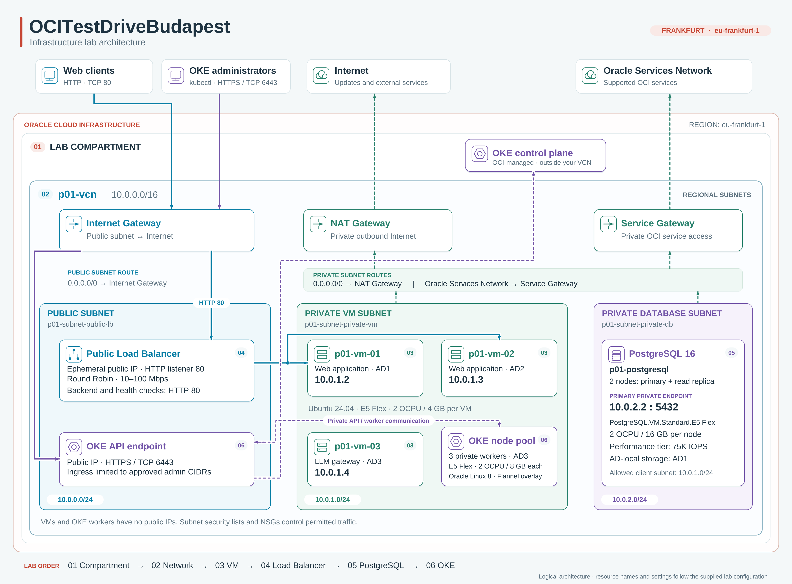

# OCITestDriveBudapest

Hands-on labs for deploying an application infrastructure on **Oracle Cloud Infrastructure (OCI)**. Build the environment step by step, from its compartment and network to virtual machines, a public load balancer, PostgreSQL, and an Oracle Kubernetes Engine (OKE) cluster.

Each lab provides an OCI Console walkthrough and a Terraform deployment option. Choose one deployment method for each lab, and complete the labs in the order below.

## Contents

- [Before you begin](#before-you-begin)
- [Hands-on labs and execution order](#hands-on-labs-and-execution-order)
- [Target architecture](#target-architecture)
- [Working with Terraform](#working-with-terraform)
- [Cleanup](#cleanup)

## Before you begin

- Access to an OCI tenancy with permissions and sufficient service limits to create the lab resources.
- Use the same OCI region and lab compartment throughout the exercises. The planned region is **Germany Central (Frankfurt)**, `eu-frankfurt-1`.
- For Terraform deployments: Terraform and OCI authentication configured as described in each lab.
- For interacting with OKE after deployment: OCI CLI and `kubectl`, configured as described in the OKE lab.

Resources can incur charges while provisioned. Review the target configuration in each lab before deploying.

## Hands-on labs and execution order

| Order | Lab | What you will deploy | Guide and code |
| --- | --- | --- | --- |
| 1 | **Compartment** | A dedicated compartment that contains the lab infrastructure. | [Compartment](./Compartment/) |
| 2 | **Network** | The VCN, three subnets, Internet Gateway, NAT Gateway, Service Gateway, route tables, and security lists. | [Network](./Network/) |
| 3 | **VM** | Three private Ubuntu VMs: two for the web application and one for an LLM gateway. | [VM](./VM/) |
| 4 | **Load Balancer** | A public flexible load balancer with an HTTP listener, health checks, and the two web VMs as backends. | [LoadBalancer](./LoadBalancer/) |
| 5 | **PostgreSQL** | A private PostgreSQL database system with two database nodes. | [PostgreSQL](./PostgreSQL/) |
| 6 | **OKE** | An OKE cluster with a public Kubernetes API endpoint and three private worker nodes. | [OKE](./OKE/) |

Start with **Compartment**, then **Network**. The later labs reuse the compartment and network; the **Load Balancer** also requires the two web **VMs**. Open each folder's README for its prerequisites, target configuration, deployment steps, troubleshooting, and Oracle documentation references.

## Target architecture

The diagram shows the planned infrastructure in **Frankfurt**, inside the lab compartment. Subnets are regional; availability domain placement is shown on the compute and database components where specified.

[Download the architecture diagram (PNG)](./ocitestdrivebudapest-architecture.png)

Use the parameters in each lab as the source of truth for exact resource names, images, supported versions, IP addresses, and availability domain identifiers. Check that private IP addresses are available and not reserved by OCI before assigning them.

## Working with Terraform

1. Open the lab folder in the execution order above.
2. Read its README and complete the prerequisites.
3. Update its separate parameter file with your tenancy, compartment, region, and preferred settings.
4. Initialize Terraform and review the plan using the commands in that lab.
5. Apply the configuration and validate the deployed resources.
6. Retain the outputs required by subsequent labs.

Keep Terraform state for each lab available until cleanup. Do not commit credentials, private keys, sensitive parameter files, or Terraform state to the repository. Avoid deploying the same resources with both Console and Terraform unless the Console-created resources are deliberately imported into Terraform state.

## Cleanup

Follow each lab's optional cleanup instructions in reverse order:

1. **OKE** — remove any workload-created load balancers and storage before deleting the cluster resources.
2. **PostgreSQL** — preserve any data you need before deleting the database system.
3. **LoadBalancer** — delete the public load balancer.
4. **VM** — delete the three VMs and any associated resources selected for removal.
5. **Network** — remove dependent resources, then the gateways, subnets, and VCN.
6. **Compartment** — delete the compartment after it is empty.

For Terraform deployments, run the destroy procedure from the corresponding lab with its original state and parameters. Verify that chargeable resources have been removed after cleanup.
